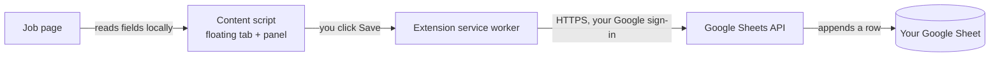

# Job Application Tracker

**Save the job you just applied to into your own Google Sheet with one click.** A free, open-source Chrome extension with no AI and no servers: one click on **Connect Google Sheets** and every job you save goes straight from your browser into a spreadsheet in your own Google Drive.

<!--
  SCREENSHOT / GIF TO CAPTURE (save it in docs/screenshots/ and replace this placeholder):
  1. A LinkedIn (or Greenhouse) job page with the floating "Save job" tab visible on the right edge.
  2. The side panel open with every field pre-filled, then clicking Save and the "Saved to row N · Open sheet" view.
  3. The Google Sheet with a few rows whose Status cells show the different colors, plus the Summary tab.
  Suggested file: docs/screenshots/demo.gif (about 1280×800, under 5 MB).
-->
> 📸 *A screenshot / demo GIF will live in [`docs/screenshots/`](docs/screenshots/).*

## Why it exists

A serious job search means dozens or hundreds of applications across LinkedIn, Naukri, company career sites and applicant tracking systems. After a few weeks it gets hard to remember where you applied, when, for which role, and whether anyone replied. Spreadsheets work well for tracking, but copying the company, role, location, salary and link out of every posting by hand is tedious, so the sheet falls behind.

This extension reads those details from the job page for you. You check them, click **Save**, and a new row appears in a Google Sheet that you own.

## Features

- **Zero setup.** Click **Connect Google Sheets**, approve Google's consent screen, and a fully formatted tracker sheet appears in your Drive.
- **One-click capture.** A small tab appears on the right edge of job postings. Click it to open a side panel with every field already filled in.
- **Works on any site.** Dedicated readers for the big job boards and ATSs, plus schema.org structured data and page heuristics for everything else.
- **Editable before saving.** Every field can be changed. Company or role is required, and the link is checked.
- **Duplicate warning.** If the job is already in your sheet, the panel says when you saved it and its current status. Links are compared after removing tracking parameters.
- **A sheet that's ready to use.** Status and work-mode dropdowns, a color for each status, a filter, frozen headers and a formula-only **Summary** tab: totals, last 7 and 30 days, response rate, interview rate, offers, and counts per status and source.
- **Automatic upkeep.** Once a day, *Last Updated* is set on rows whose status you changed, and applications with no movement for 30 days are marked **Ghosted**. You can change the number of days or turn ghosting off.
- **Keyboard friendly.** Press `Alt+Shift+J` on any page to open the panel and `Esc` to close it. Typing in the panel is kept away from the site's own keyboard shortcuts.
- **Private by design.** Data goes only from your browser to your own Google Sheet. The extension can only see the spreadsheet it created. No analytics, no tracking, no servers.
- **Light and dark mode**, and no build step: plain JavaScript you can read.

## How it works



1. The content script checks each page to see whether it looks like a job posting.
2. When you open the panel, it extracts the fields with deterministic rules (no AI): a site-specific reader first, then schema.org `JobPosting` data, then general page heuristics.
3. When you save, the extension's service worker appends the row to your sheet through the Google Sheets API, signed in as you. Nothing passes through any other server.

The full design is in [docs/ARCHITECTURE.md](docs/ARCHITECTURE.md).

## Supported sites

**Any website.** Pages are detected and read through schema.org structured data (which most career sites publish) and general page heuristics: title, headings, "Location:" labels and the job description.

**Extra-accurate readers** with site-specific selectors:

| Job boards | Applicant tracking systems |
|---|---|
| LinkedIn (job pages and search results) | Greenhouse |
| Naukri | Lever |
| Indeed (all country domains) | Workday (`myworkdayjobs.com`, `myworkdaysite.com`) |
| Glassdoor (all country domains) | Ashby |

Greenhouse boards embedded on a company's own careers page (links with `?gh_jid=`) are detected too. The job details sit inside Greenhouse's frame there, which the page can't read, so the panel fills in the company and link, and the role usually needs typing.

The **Source** column is also filled automatically for SmartRecruiters, iCIMS, Wellfound, Instahyre, Foundit, Cutshort, Hirist, Internshala, Taleo, SuccessFactors, Oracle Cloud, BambooHR, Workable, Recruitee, Jobvite, Teamtailor and Zoho Recruit. Any other site is labelled *Company Site*, and you can always edit it.

## The sheet

Connecting creates a spreadsheet called **Job Applications Tracker** in your Google Drive. Its **Applications** tab has these columns:

| Column | What goes in it |
|---|---|
| Company | From the page. Editable. |
| Role | From the page. Editable. |
| Applied Date | Today by default, shown as `03 Oct 2026` |
| Status | Dropdown, default **Applied** |
| Work Mode | Dropdown: On-site, Remote, Hybrid, N/A |
| Location | From the page |
| YOE | Years of experience from the description, e.g. `3+ yrs`, `2-5 yrs`, `Fresher`, `N/A` (stored as text) |
| Salary / CTC | From structured data, the site, or the description (supports `12-18 LPA`, `₹`, `$`, `€`, `£`) |
| Source | LinkedIn, Naukri, Greenhouse, … or Company Site |
| Job Link | Cleaned link without tracking or search parameters, so the same job always gets the same link |
| Last Updated | Set when the row is added, when you change Status (picked up by the daily check) and when a row is ghosted |
| Notes | Anything you like |

**Status colors**

| | Status | | Status |
|---|---|---|---|
| ⬜ | Saved (light grey) | 🟩 | Offer (green) |
| 🟦 | Applied (blue) | 🟥 | Rejected (red) |
| 🟪 | OA / Assessment (purple) | ⬛ | Ghosted (dark grey) |
| 🟨 | Interview (amber) | 🟫 | Withdrawn (brown) |

A **Summary** tab shows total applications, applications in the last 7 and 30 days, response rate, interview rate, offers, and a breakdown by status and by source. It uses formulas only, so it always reflects the current data.

## Installation

Install **Job Application Tracker** from the Chrome Web Store:

> **[Chrome Web Store: link coming soon](https://chromewebstore.google.com/)**
> <!-- Replace with the listing URL once the item is published. -->

It works in Google Chrome, Microsoft Edge, Brave and other Chromium-based browsers (version 116 or newer). To run it from source instead, see [Development](#development).

## Getting started

1. After installing, the settings page opens by itself. You can also right-click the extension icon and choose **Options**.
2. Click **Connect Google Sheets**.
3. Pick your Google account and approve the consent screen. The extension asks for one permission: to see and edit only the Google Drive files it creates.
4. A **Job Applications Tracker** spreadsheet is created in your Drive, with dropdowns, colors, a filter and a Summary tab. If you connected before, for example on another computer, you can choose **Use existing sheet** or **Create new** instead.
5. The page shows **✓ Connected** with an **Open sheet** link.

That's all. Open any job posting and look for the tab on the right edge.

To stop, click **Disconnect** in the settings. This revokes the extension's access to your Google account. Your sheet stays in your Drive.

## Usage

1. Open a job posting. On pages that look like a job, a **Save job** tab appears on the right edge of the screen.
2. Click it. A side panel opens with Company, Role, Applied Date, Status, Work Mode, Location, YOE, Salary / CTC, Source, Job Link and Notes already filled in.
3. Check the fields, edit anything that's off, and click **Save**. The panel confirms the row number, with an **Open sheet** link.

More ways to use it:

- **Any page, even if the tab doesn't appear:** click the toolbar icon or press **`Alt+Shift+J`**. Press **`Esc`** to close the panel.
- **Already saved?** A yellow banner shows the date you saved the job and its current status. You can still save it again.
- **Hide the tab on a site:** hover over the tab and click the small **×**. You can bring it back from the settings page.
- **Keep the sheet current:** change a row's **Status** from the dropdown as things progress. *Last Updated* follows within a day.
- **Stale applications** are marked **Ghosted** once a day.

Both daily checks run inside the extension, so they only happen while the browser is open. If the browser was closed, they catch up about a minute after it starts.

## Settings

| Setting | Options |
|---|---|
| Google Sheets | **Connect Google Sheets**, **Open sheet**, **Disconnect** |
| Automatic upkeep | Mark **Applied** and **OA / Assessment** rows as **Ghosted** (on by default) after a number of days without a change (default 30, from 1 to 365) |
| Floating button | **Auto**: job pages only (default) · **Always**: every site · **Never**: toolbar icon and shortcut only |
| Hidden sites | Sites where you clicked ×. Remove one to show the tab there again. |
| Keyboard shortcut | Shown on the settings page. Change it at `chrome://extensions/shortcuts`. |

## Privacy & permissions

**Your data stays in your own Google account.** The extension talks only to Google's Sheets and Drive APIs, signed in as you, and nothing else. There are no servers run by this project, no analytics, no tracking, no ads and no remote configuration. Page content is processed locally in your browser. The full policy is in [PRIVACY.md](PRIVACY.md).

**It can only see the sheet it creates.** Sign-in asks for a single Google scope, `drive.file`, described by Google as "See, edit, create, and delete only the specific Google Drive files you use with this app". The extension cannot list, open or read any other file in your Drive, including your other spreadsheets. To find a tracker it made before, it looks for a private tag that only this extension can set and read.

You can revoke access at any time with **Disconnect**, or from your Google Account at [myaccount.google.com/permissions](https://myaccount.google.com/permissions).

| Permission | Why it's needed |
|---|---|
| `identity` | Signs you in with Google so the extension can write to your sheet. |
| `storage` | Saves your settings (button mode, hidden sites, upkeep options) and the ID of your sheet. |
| `alarms` | Runs the daily upkeep: *Last Updated* after status changes, and auto-Ghosted. |
| `activeTab` | When you click the toolbar icon or press the shortcut on a tab that was open before the extension was installed, this lets the extension add the panel to that one tab. |
| `scripting` | Performs the injection described above. |
| `sheets.googleapis.com`, `www.googleapis.com` | The Google Sheets API (create the sheet, add rows, look up links) and the Google Drive API (tag the sheet and find it again). |
| Content script on all `http`/`https` pages | Needed to recognize job postings on *any* website and read their fields. This is why Chrome says the extension can "read and change all your data on all websites". The content script only reads the page. It makes no network requests and sends nothing until you click **Save**. |

## Troubleshooting / FAQ

**"Can't open your tracker sheet… click Reconnect."**
The sheet was deleted (or moved to the trash), or the extension's access was removed from your Google Account. Open the settings and click **Reconnect**. You can pick an existing tracker or create a new one.

**"Google sign-in is needed."**
Your sign-in expired or was revoked. Open the settings and click **Connect Google Sheets** again. In Edge, Brave and other non-Chrome browsers, Google's sign-in lasts about an hour and is renewed silently while you're signed in to Google in that browser.

**The consent screen says "Google hasn't verified this app".**
You are using a development build, or the extension is still in Google's testing phase. Click **Continue** only if you installed it yourself from this repository.

**Is the old Apps Script setup still needed?**
No. The extension now talks to Google Sheets directly. Your old sheet and its Apps Script stay in your Drive untouched. You can delete the Web App deployment, or keep using that sheet by hand. From now on the extension writes to its own new tracker.

**Last Updated or Ghosted didn't change.**
Both run once a day while the browser is open, and about a minute after it starts. Check that **Automatic upkeep** is on in the settings and that you are connected.

**The floating button doesn't show up.**
- In **Auto** mode the tab only appears on pages that look like job postings. Use the toolbar icon or `Alt+Shift+J` on any page, or switch the button to **Always**.
- Check **Hidden sites** in the settings. You may have clicked × on this site.
- Tabs that were already open when you installed or updated the extension need a reload. The toolbar icon works on them right away.
- Browser pages such as `chrome://` pages, the Chrome Web Store and the built-in PDF viewer can't be scripted by any extension. Clicking the icon there shows a red **!** badge to say so.

**A field was extracted wrong.**
Edit it in the panel before saving. Every field is editable. Job sites change their layouts from time to time. If a supported site keeps getting something wrong, please [open an issue](https://github.com/piyushd12/job-application-tracking-extension/issues) with the page URL (or the site name), the field and the value you expected.

**Can I rename the sheet or move it to another folder?**
Yes. Renaming or moving the spreadsheet is fine. Keep the **Applications** tab name and its column order, because the extension writes by position.

**"The extension was updated. Reload this page and try again."**
The extension was reloaded or updated while this tab was open. Reload the page.

**The shortcut doesn't work.**
Another extension or the browser may already use `Alt+Shift+J`. Pick a different shortcut at `chrome://extensions/shortcuts`.

## Project structure

```
.
├── extension/                 # the extension; load this folder unpacked
│   ├── manifest.json          # Manifest V3
│   ├── config.js              # Google OAuth client IDs
│   ├── background.js          # service worker: message router, toolbar, shortcut, daily alarm
│   ├── lib/
│   │   └── sheets.js          # Google sign-in, Sheets/Drive REST calls, sheet layout, daily upkeep
│   ├── content/
│   │   ├── extract.js         # extraction: site readers, JSON-LD, heuristics, field rules
│   │   └── ui.js              # floating tab + side panel (Shadow DOM)
│   ├── options/               # settings page
│   └── icons/                 # generated PNG icons
├── scripts/make-icons.js      # regenerates the icons (Node only, no dependencies)
├── tests/                     # node:test suites and synthetic HTML fixtures
├── docs/
│   ├── ARCHITECTURE.md        # design, contracts, extraction strategy
│   ├── GOOGLE_CLOUD_SETUP.md  # maintainers: OAuth clients, consent screen, extension key
│   ├── PUBLISHING.md          # maintainers: Chrome Web Store submission
│   └── TESTING.md             # manual QA checklist for a real browser and sheet
└── PRIVACY.md                 # privacy policy (also used for the store listing)
```

## Development

Requirements: Node.js 22 or newer, and a Google Cloud project with OAuth clients for sign-in.

### Run from source

1. Clone the repository:
   ```sh
   git clone https://github.com/piyushd12/job-application-tracking-extension.git
   ```
2. Set up Google sign-in once, as described in [docs/GOOGLE_CLOUD_SETUP.md](docs/GOOGLE_CLOUD_SETUP.md): create the OAuth clients, put their IDs in `extension/config.js` and `extension/manifest.json`, and optionally add a manifest `key` so the extension ID never changes.
3. Open `chrome://extensions` (Edge: `edge://extensions`, Brave: `brave://extensions`) and turn on **Developer mode**.
4. Click **Load unpacked** and select the **`extension`** folder inside the repository (not the repository root).
5. The settings page opens. Click **Connect Google Sheets**.

There is no build step. After editing files in `extension/`, click the reload icon on the extension's card in `chrome://extensions` and reload the page you're testing.

### Tests

```sh
npm install     # installs jsdom, the only (dev) dependency
npm test        # runs every test with Node's built-in test runner
npm run icons   # regenerates extension/icons
```

The tests cover:

- **Field parsers:** years of experience, work mode, salary, canonical URLs and source names.
- **Extraction fixtures:** one synthetic HTML page per supported site, a structured-data-only page, a plain career page, a stale-data single-page-app case, and edge cases such as multiple locations, Greenhouse embeds, malformed structured data and very long descriptions.
- **In-page panel and settings page:** `ui.js` and the options page run in jsdom with a mocked `chrome` API.
- **Sheets layer:** `lib/sheets.js` runs in `node:vm` with a mocked `fetch` and `chrome.identity`. It covers the exact request bodies that create and format the sheet, appending rows, duplicate lookup, the 401 retry, the Edge/Brave sign-in fallback, and the daily ghosting and *Last Updated* logic.
- **Service worker:** message routing, error messages, the connect flow, the toolbar fallback and the daily alarm.

Automated tests can't cover real sites, real Google accounts or how the panel looks, so [docs/TESTING.md](docs/TESTING.md) has a manual checklist to run in Chrome before a release. Publishing steps are in [docs/PUBLISHING.md](docs/PUBLISHING.md).

## Roadmap

- More dedicated readers: SmartRecruiters, Workable, Wellfound and Instahyre.
- A status-history tab, so the interview rate also counts jobs that later moved to Rejected.
- A quick "Saved for later" action from the toolbar.
- A Firefox build.

Ideas and votes are welcome in [Issues](https://github.com/piyushd12/job-application-tracking-extension/issues).

## Contributing

Contributions are welcome. Bug reports, new site readers, fixture improvements and docs fixes are all useful.

1. Fork the repository and create a branch.
2. Keep changes focused, and add or update tests for any extraction or Sheets change.
3. Run `npm test` and make sure everything passes.
4. Open a pull request that explains what changed and why.

Please keep the project's principles in mind: plain JavaScript with no build step, no runtime dependencies, no AI or LLM calls, and no network requests to anything except Google's Sheets and Drive APIs on the user's behalf.

## License

[MIT](LICENSE) © piyushd12
