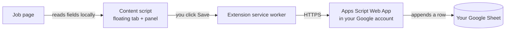

# Job Application Tracker

**Save the job you just applied to into your own Google Sheet with one click.** A free, open-source Chrome extension with no AI, no accounts, and no servers other than your own sheet.

<!--
  SCREENSHOT / GIF TO CAPTURE (save it in docs/screenshots/ and replace this placeholder):
  1. A LinkedIn (or Greenhouse) job page with the floating "Save job" tab visible on the right edge.
  2. The side panel open with every field pre-filled, then clicking Save and the "Saved to row N · Open sheet" view.
  3. The Google Sheet with a few rows whose Status cells show the different colors, plus the Summary tab.
  Suggested file: docs/screenshots/demo.gif (about 1280×800, under 5 MB).
-->
> 📸 *A screenshot / demo GIF will live in [`docs/screenshots/`](docs/screenshots/).*

## Why it exists

A serious job search means dozens or hundreds of applications across LinkedIn, Naukri, company career sites and applicant tracking systems. After a few weeks it gets hard to remember where you applied, when, for which role, and whether anyone replied. Spreadsheets work well for tracking, but copying the company, role, location, salary and link out of every posting by hand is tedious, so the sheet falls behind.

This extension reads those details from the job page for you. You check them, click **Save**, and a new row appears in a Google Sheet that you own.

## Features

- **One-click capture.** A small tab appears on the right edge of job postings. Click it to open a side panel with every field already filled in.
- **Works on any site.** Dedicated readers for the big job boards and ATSs, plus schema.org structured data and page heuristics for everything else.
- **Editable before saving.** Every field can be changed. Company or role is required, and the link is checked.
- **Duplicate warning.** If the job is already in your sheet, the panel says when you saved it and its current status. Links are compared after removing tracking parameters.
- **A sheet that's ready to use.** Status and work-mode dropdowns, a color for each status, a filter, frozen headers and a formula-only **Summary** tab: totals, last 7 and 30 days, response rate, interview rate, offers, and counts per status and source.
- **Automatic upkeep.** *Last Updated* refreshes whenever you change a status. Applications with no movement for 30 days are marked **Ghosted** automatically, and you can turn that off.
- **Keyboard friendly.** Press `Alt+Shift+J` on any page to open the panel and `Esc` to close it. Typing in the panel is kept away from the site's own keyboard shortcuts.
- **Private by design.** Data goes only from your browser to your own Google Apps Script. No analytics, no tracking, no third-party servers.
- **Light and dark mode**, and no build step: plain JavaScript you can read.

## How it works



1. The content script checks each page to see whether it looks like a job posting.
2. When you open the panel, it extracts the fields with deterministic rules (no AI): a site-specific reader first, then schema.org `JobPosting` data, then general page heuristics.
3. When you save, the extension's service worker sends the job to the Apps Script Web App you deployed from your own sheet. The script validates the data and appends the row.

The full design is in [docs/ARCHITECTURE.md](docs/ARCHITECTURE.md).

## Supported sites

**Any website.** Pages are detected and read through schema.org structured data (which most career sites publish) and general page heuristics: title, headings, "Location:" labels and the job description.

**Extra-accurate readers** with site-specific selectors:

| Job boards | Applicant tracking systems |
|---|---|
| LinkedIn (job pages and search results) | Greenhouse |
| Naukri | Lever |
| Indeed (all country domains) | Workday (`myworkdayjobs.com`, `myworkdaysite.com`) |
| Glassdoor (all country domains) | Ashby |

The **Source** column is also filled automatically for SmartRecruiters, iCIMS, Wellfound, Instahyre, Foundit, Cutshort, Hirist, Internshala, Taleo, SuccessFactors, Oracle Cloud, BambooHR, Workable, Recruitee, Jobvite, Teamtailor and Zoho Recruit. Any other site is labelled *Company Site*, and you can always edit it.

## The sheet

Running `setup` creates an **Applications** tab with these columns:

| Column | What goes in it |
|---|---|
| Company | From the page. Editable. |
| Role | From the page. Editable. |
| Applied Date | Today by default, shown as `03 Oct 2026` |
| Status | Dropdown, default **Applied** |
| Work Mode | Dropdown: On-site, Remote, Hybrid, N/A |
| Location | From the page |
| YOE | Years of experience from the description, e.g. `3+ yrs`, `2-5 yrs`, `Fresher`, `N/A` (stored as text) |
| Salary / CTC | From structured data, the site, or the description (supports `12-18 LPA`, `₹`, `$`, `€`, `£`) |
| Source | LinkedIn, Naukri, Greenhouse, … or Company Site |
| Job Link | Cleaned link without tracking parameters |
| Last Updated | Set when the row is added and whenever Status changes |
| Notes | Anything you like |

**Status colors**

| | Status | | Status |
|---|---|---|---|
| ⬜ | Saved (light grey) | 🟩 | Offer (green) |
| 🟦 | Applied (blue) | 🟥 | Rejected (red) |
| 🟪 | OA / Assessment (purple) | ⬛ | Ghosted (dark grey) |
| 🟨 | Interview (amber) | 🟫 | Withdrawn (brown) |

A **Summary** tab shows total applications, applications in the last 7 and 30 days, response rate, interview rate, offers, and a breakdown by status and by source. It uses formulas only, so it always reflects the current data.

## Installation

Setup takes about five minutes. It has three parts: the sheet, the extension, and connecting the two.

### Part 1: Create your sheet and Web App

1. Create a new Google Sheet (open [sheets.new](https://sheets.new)) and give it a name, for example *Job Hunt*.
2. In the sheet, open **Extensions → Apps Script**.
3. Delete everything in the editor's `Code.gs` and paste in the contents of [`apps-script/Code.gs`](apps-script/Code.gs). Optionally, set a `SECRET` at the top (see [Configuration](#configuration)).
4. *(Optional, recommended.)* Open **Project Settings** (gear icon), tick **Show "appsscript.json" manifest file in editor**, open `appsscript.json` and replace its contents with [`apps-script/appsscript.json`](apps-script/appsscript.json). This limits the script's access to this one spreadsheet.
5. Click **Save**, choose **`setup`** in the function dropdown next to **Run**, then click **Run**.
6. Google asks for authorization: **Review permissions** → pick your account → **Advanced** → **Go to *(project name)* (unsafe)** → **Allow**. The warning appears because the script is your own and hasn't been reviewed by Google. It only runs inside your account.
7. Go back to the sheet. You now have **Applications** and **Summary** tabs, and a **Job Tracker** menu (reload the sheet if the menu isn't there yet).
8. In Apps Script, click **Deploy → New deployment**, click the gear next to *Select type* and choose **Web app**, then set:
   - **Execute as:** *Me*
   - **Who has access:** *Anyone*
9. Click **Deploy** and copy the **Web app URL**. It ends in `/exec`.

> **After editing `Code.gs` later**, go to **Deploy → Manage deployments → ✏️ Edit → Version: New version → Deploy**. The URL stays the same.

### Part 2: Load the extension

1. Download this repository: **Code → Download ZIP** (then unzip it), or run:
   ```sh
   git clone https://github.com/piyushd12/job-application-tracking-extension.git
   ```
2. Open the extensions page:
   - Chrome: `chrome://extensions`
   - Edge: `edge://extensions`
   - Brave: `brave://extensions`
3. Turn on **Developer mode**.
4. Click **Load unpacked** and select the **`extension`** folder inside the repository (not the repository root).
5. *(Optional)* Pin the extension from the puzzle-piece menu so its icon is always visible.

### Part 3: Connect the extension to your sheet

1. The settings page opens automatically after installation. You can also right-click the extension icon and choose **Options**.
2. Paste the Web App URL from Part 1. If you set a `SECRET` in `Code.gs`, enter the same value under **Secret**.
3. Click **Test connection**. You should see something like **✓ Connected to "Job Hunt" · 0 jobs saved. Settings saved.**

You're done. Open any job posting and look for the tab on the right edge.

## Usage

1. Open a job posting. On pages that look like a job, a **Save job** tab appears on the right edge of the screen.
2. Click it. A side panel opens with Company, Role, Applied Date, Status, Work Mode, Location, YOE, Salary / CTC, Source, Job Link and Notes already filled in.
3. Check the fields, edit anything that's off, and click **Save**. The panel confirms the row number, with an **Open sheet** link.

More ways to use it:

- **Any page, even if the tab doesn't appear:** click the toolbar icon or press **`Alt+Shift+J`**. Press **`Esc`** to close the panel.
- **Already saved?** A yellow banner shows the date you saved the job and its current status. You can still save it again.
- **Hide the tab on a site:** hover over the tab and click the small **×**. You can bring it back from the settings page.
- **Keep the sheet current:** change a row's **Status** from the dropdown as things progress. *Last Updated* updates by itself.
- **Mark stale applications:** this happens daily. To run it now, use **Job Tracker → Mark ghosted now** in the sheet.

## Configuration

### Apps Script settings (top of `Code.gs`)

| Setting | Default | Meaning |
|---|---|---|
| `SECRET` | `''` (off) | Optional shared token. When set, the extension must send the same value (enter it in the extension settings). Recommended. |
| `AUTO_GHOST` | `true` | Every day, mark **Applied** and **OA / Assessment** rows as **Ghosted** when nothing has changed for `GHOST_AFTER_DAYS`. |
| `GHOST_AFTER_DAYS` | `30` | Days without a change before a row is ghosted. |

After changing these, save the script, run **Job Tracker → Run setup** (this re-creates or removes the daily trigger), and deploy a new version if you changed `SECRET`. The daily job runs around 06:00 in the script's time zone, set by `timeZone` in `appsscript.json`.

### Extension settings

| Setting | Options |
|---|---|
| Web App URL | The `/exec` URL from your deployment |
| Secret | Must match `SECRET` in `Code.gs`, or stay empty |
| Floating button | **Auto**: job pages only (default) · **Always**: every site · **Never**: toolbar icon and shortcut only |
| Hidden sites | Sites where you clicked ×. Remove one to show the tab there again. |
| Keyboard shortcut | Shown on the settings page. Change it at `chrome://extensions/shortcuts`. |

## Privacy & permissions

**Your data never leaves your own Google account.** The extension sends the fields you save to the Apps Script Web App that *you* deployed, and nowhere else. There are no analytics, no tracking, no ads, no remote configuration and no third-party servers. Page content is processed locally in your browser.

| Permission | Why it's needed |
|---|---|
| `storage` | Saves your settings: Web App URL, secret, button mode, hidden sites. |
| `activeTab` | When you click the toolbar icon or press the shortcut on a tab that was open before the extension was installed, this lets the extension add the panel to that one tab. |
| `scripting` | Performs the injection described above. |
| `script.google.com`, `script.googleusercontent.com` | Lets the extension call your Apps Script Web App. Google serves the script's responses from `googleusercontent.com`. |
| Content script on all `http`/`https` pages | Needed to recognize job postings on *any* website and read their fields. This is why Chrome says the extension can "read and change all your data on all websites". The content script only reads the page. It makes no network requests and sends nothing until you click **Save**. |

**About "Who has access: Anyone".** The extension calls your Web App without your Google login, so the deployment has to accept anonymous requests. The script still runs as you, and it can only append rows to this sheet and look up existing links. Anyone who learned your Web App URL could add rows, so set a `SECRET` for extra protection. It is a simple shared token, sent in requests and stored in your browser profile, so pick a random value you don't use anywhere else.

## Troubleshooting / FAQ

**"Google returned a sign-in page."**
The Web App isn't deployed for *Anyone*. In Apps Script, open **Deploy → Manage deployments → ✏️ Edit**, set **Who has access: Anyone**, choose **Version: New version** and click **Deploy**. Also check that you pasted the URL ending in `/exec`, not the `/dev` test URL.

**"The secret doesn't match the SECRET in Code.gs."**
The value in the extension settings must equal `SECRET` in `Code.gs` exactly. If you changed `Code.gs`, deploy a **new version**, because the old version keeps running until you do.

**"The sheet isn't set up yet."**
In the sheet, choose **Job Tracker → Run setup**, or run `setup` from the Apps Script editor. This also fixes renamed or deleted headers.

**The floating button doesn't show up.**
- In **Auto** mode the tab only appears on pages that look like job postings. Use the toolbar icon or `Alt+Shift+J` on any page, or switch the button to **Always**.
- Check **Hidden sites** in the settings. You may have clicked × on this site.
- Tabs that were already open when you installed or updated the extension need a reload. The toolbar icon works on them right away.
- Browser pages such as `chrome://` pages and the Chrome Web Store can't be scripted by any extension.

**A field was extracted wrong.**
Edit it in the panel before saving. Every field is editable. Job sites change their layouts from time to time. If a supported site keeps getting something wrong, please [open an issue](https://github.com/piyushd12/job-application-tracking-extension/issues) with the page URL (or the site name), the field and the value you expected.

**Can setup be re-run? Will it delete existing rows?**
Choose **Job Tracker → Run setup** at any time. It only touches formatting, dropdowns, colors, the filter, the Summary tab and the daily trigger. Your rows are never deleted.

**"The extension was updated. Reload this page and try again."**
The extension was reloaded or updated while this tab was open. Reload the page.

**The shortcut doesn't work.**
Another extension or the browser may already use `Alt+Shift+J`. Pick a different shortcut at `chrome://extensions/shortcuts`.

## Project structure

```
.
├── extension/                 # the extension; load this folder unpacked
│   ├── manifest.json          # Manifest V3
│   ├── background.js          # service worker: Web App calls, toolbar, shortcut, first-run
│   ├── content/
│   │   ├── extract.js         # extraction: site readers, JSON-LD, heuristics, field rules
│   │   └── ui.js              # floating tab + side panel (Shadow DOM)
│   ├── options/               # settings page
│   └── icons/                 # generated PNG icons
├── apps-script/
│   ├── Code.gs                # Web App API, sheet setup, Summary, triggers, menu
│   └── appsscript.json        # Apps Script manifest
├── scripts/make-icons.js      # regenerates the icons (Node only, no dependencies)
├── tests/                     # node:test suites and synthetic HTML fixtures
└── docs/ARCHITECTURE.md       # design, contracts, extraction strategy
```

## Development

Requirements: Node.js 22 or newer.

```sh
npm install     # installs jsdom, the only (dev) dependency
npm test        # runs every test with Node's built-in test runner
npm run icons   # regenerates extension/icons
```

There is no build step. After editing files in `extension/`, click the reload icon on the extension's card in `chrome://extensions` and reload the page you're testing.

The tests cover:

- **Field parsers:** years of experience, work mode, salary, canonical URLs and source names.
- **Extraction fixtures:** one synthetic HTML page per supported site, a structured-data-only page, a plain career page and a stale-data single-page-app case.
- **Apps Script:** `Code.gs` runs inside `node:vm` with in-memory mocks of `SpreadsheetApp`, `LockService`, `ContentService` and `ScriptApp`.

### Adding a new site reader

1. In [`extension/content/extract.js`](extension/content/extract.js), add an entry to `SITE_READERS`:
   ```js
   {
     name: 'Example',
     matches: (host) => hostIs(host, 'example.com'),
     isJobPage: (doc, url) => /\/jobs\/\d+/.test(url),
     read: (doc, url) => ({
       role: pick(doc, '[data-testid="job-title"]', 'h1'),
       company: pick(doc, '[data-testid="company-name"]'),
       location: pick(doc, '[data-testid="job-location"]'),
       description: pick(doc, '[data-testid="job-description"]'),
     }),
   },
   ```
   List several selectors per field, most stable first: `data-testid`, `data-automation-id`, `itemprop` or `id` before class names. Fields left empty fall back to structured data and heuristics.
2. If the site should get its own **Source** label, add it to `SOURCES` in the same file.
3. Add a small, synthetic fixture in `tests/fixtures/` that mimics the site's markup. It must contain no real job post or personal data.
4. Add a case to the table in [`tests/extract.test.js`](tests/extract.test.js) and run `npm test`.

## Roadmap

- More dedicated readers: SmartRecruiters, Workable, Wellfound and Instahyre.
- A status-history tab, so the interview rate also counts jobs that later moved to Rejected.
- A quick "Saved for later" action from the toolbar.
- A Firefox build.

Ideas and votes are welcome in [Issues](https://github.com/piyushd12/job-application-tracking-extension/issues).

## Contributing

Contributions are welcome. Bug reports, new site readers, fixture improvements and docs fixes are all useful.

1. Fork the repository and create a branch.
2. Keep changes focused, and add or update tests for any extraction or Apps Script change.
3. Run `npm test` and make sure everything passes.
4. Open a pull request that explains what changed and why.

Please keep the project's principles in mind: plain JavaScript with no build step, no runtime dependencies, no AI or LLM calls, and no network requests to anything except the user's own Apps Script.

## License

[MIT](LICENSE) © piyushd12
