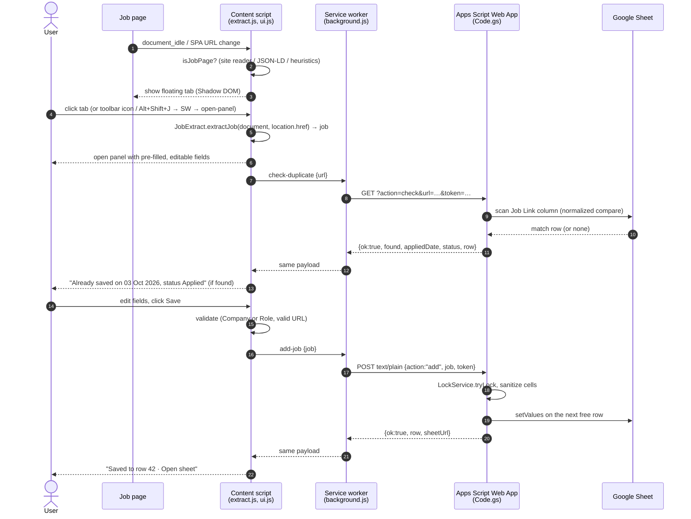

# Architecture

This document describes the design of **Job Application Tracker**. It is a Manifest V3 browser extension that saves the job you just applied to into your own Google Sheet with one click. It is written for developers who want to understand, review or contribute to the project.

## Contents

1. [Overview and assumptions](#1-overview-and-assumptions)
2. [Request flow](#2-request-flow)
3. [Folder structure](#3-folder-structure)
4. [Sheet data model](#4-sheet-data-model)
5. [Message contracts](#5-message-contracts)
6. [Apps Script API contract](#6-apps-script-api-contract)
7. [Extraction strategy](#7-extraction-strategy)
8. [Security and privacy](#8-security-and-privacy)
9. [Testing strategy](#9-testing-strategy)
10. [Milestone roadmap](#10-milestone-roadmap)

---

## 1. Overview and assumptions

### What it does

- On a page detected as a job posting, a small floating tab appears on the right edge of the screen.
- Clicking the tab opens a side panel. Every field is pre-filled from the page and can be edited.
- The user clicks **Save**, and a row is appended to their Google Sheet.
- The toolbar icon and **Alt+Shift+J** open the same panel on any page, even where auto-detection missed it.
- A small **×** on the floating tab hides it for that site.
- A setting chooses when the tab shows: `auto` (job pages only, the default), `always` or `never`.

### Moving parts

| Part | Runs in | Responsibility |
|---|---|---|
| Content scripts | Every http/https page (isolated world) | Detect job pages, extract fields, render the button and panel in Shadow DOM |
| Service worker | Extension background | Every network call to the Web App, toolbar/shortcut handling, first-run options page |
| Options page | Extension page | Web App URL, secret, test connection, button mode, hidden sites |
| Apps Script Web App | Google, bound to the user's sheet | Validate, deduplicate, append rows, sheet setup, triggers |
| Google Sheet | User's Drive | The data. The Summary tab is built from formulas only |

### Assumptions

- **One user, one sheet.** Each user makes their own copy of the sheet, pastes `Code.gs` into its bound Apps Script project, runs `setup()` and deploys a Web App with *Execute as: Me* and *Who has access: Anyone*. The project runs no shared backend.
- **No build step.** The extension is plain JavaScript and is loaded unpacked in Chrome, Edge or Brave (Chromium 116+). It uses no frameworks, bundlers or transpilers.
- **Deterministic extraction only.** It uses no LLM or AI APIs. Every value comes from selectors, structured data or regular expressions, so the same page always gives the same result.
- **English-first heuristics.** YOE, work-mode and salary patterns target English job posts. Site readers and JSON-LD work for any language.
- **Redeploys are manual.** After changing `Code.gs`, the user creates a new deployment version. The `/exec` URL stays the same when they edit the existing deployment.
- **Apps Script always returns HTTP 200.** A Web App cannot set status codes, so success or failure is carried in the JSON body (`ok`).

---

## 2. Request flow



The service worker makes every network call. Content scripts run under the page's origin rules and would hit CORS. The extension has host permissions for `script.google.com` and `script.googleusercontent.com`, which is where the Web App redirects its response.

---

## 3. Folder structure

```
.
├── extension/                 # load this folder unpacked
│   ├── manifest.json
│   ├── background.js          # service worker: fetch, commands, action click, onInstalled
│   ├── content/
│   │   ├── extract.js         # pure logic: site readers, JSON-LD, heuristics, field parsers, canonicalUrl, source map
│   │   └── ui.js              # Shadow DOM button + panel, SPA watcher, messaging
│   ├── options/
│   │   ├── options.html
│   │   └── options.js
│   └── icons/                 # 16, 32, 48, 128 px PNG
├── apps-script/
│   ├── Code.gs                # doGet/doPost, setup, onOpen, onEdit, markGhosted
│   └── appsscript.json        # manifest: webapp config, scopes, runtime V8
├── tests/
│   ├── fixtures/              # synthetic HTML per site + jsonld-only + plain-career page
│   ├── fields.test.js         # YOE, work mode, salary, canonical URL, source map
│   ├── extract.test.js        # fixture-driven end-to-end extraction
│   └── apps-script.test.js    # Code.gs in node:vm with mocked Google services
├── docs/
│   └── ARCHITECTURE.md
├── package.json               # "test": "node --test"; devDependencies: jsdom only
├── README.md
└── LICENSE
```

### Module loading without a build step

`extract.js` uses a small UMD wrapper. Chrome loads it as a content script that sets a global in the extension's isolated world, and Node loads it with `require` for tests:

```js
(function (root, factory) {
  const api = factory();
  if (typeof module === 'object' && module.exports) module.exports = api;
  else root.JobExtract = api;
})(globalThis, function () { /* … */ return { extractJob, isLikelyJobPage, /* … */ }; });
```

The public API is `JobExtract = { extractJob, isLikelyJobPage, canonicalUrl, extractYOE, workModeFrom, salaryFromText }`, plus `sourceFromHost`, `readJsonLdPostings` and `SOURCE_NAMES` for the UI and tests. The site readers live inside `extract.js` as a plain array, so the whole extraction pipeline is one file with no load-order coupling. The manifest loads `extract.js` before `ui.js`.

### Manifest essentials

```jsonc
{
  "manifest_version": 3,
  "permissions": ["storage", "activeTab", "scripting"],
  "host_permissions": ["https://script.google.com/*", "https://script.googleusercontent.com/*"],
  "background": { "service_worker": "background.js" },
  "action": { "default_title": "Save this job to your sheet (Alt+Shift+J)" },
  "commands": { "_execute_action": { "suggested_key": { "default": "Alt+Shift+J" } } },
  "options_ui": { "page": "options/options.html", "open_in_tab": true },
  "content_scripts": [{
    "matches": ["http://*/*", "https://*/*"],
    "js": ["content/extract.js", "content/ui.js"],
    "run_at": "document_idle"
  }]
}
```

---

## 4. Sheet data model

### `Applications` tab

The header is in row 1, which is frozen. Data starts at row 2. `setup()` pre-formats about 1,000 data rows (plain-text columns, date formats, dropdowns, status colors) and a filter covers all of them. When fewer than 50 empty rows remain, `add` inserts 500 more and re-applies the same formatting, so new rows never lose their dropdowns or colors.

| # | Column | Stored as | Format / validation | Set by |
|---|---|---|---|---|
| A | Company | Text | `@` plain text | Panel |
| B | Role | Text | `@` | Panel |
| C | Applied Date | Date | `dd mmm yyyy` | Panel (defaults to today). Sent as `YYYY-MM-DD`, which Sheets parses in the spreadsheet time zone |
| D | Status | Text | Dropdown (strict): Saved, Applied, OA / Assessment, Interview, Offer, Rejected, Ghosted, Withdrawn | Panel (default `Applied`) |
| E | Work Mode | Text | Dropdown (strict): On-site, Remote, Hybrid, N/A | Panel |
| F | Location | Text | `@` | Panel |
| G | YOE | Text | `@` so `2-5` never becomes a date | Panel (`3+ yrs`, `2-5 yrs`, `Fresher`, `N/A`) |
| H | Salary / CTC | Text | `@` | Panel (blank if none found) |
| I | Source | Text | `@` | Panel (from hostname, editable) |
| J | Job Link | Text | `@` | Panel (canonical URL). Used for duplicate checks |
| K | Last Updated | Date-time | `dd mmm yyyy` | Server on add; `onEdit` on Status change; `markGhosted` |
| L | Notes | Text | `@` | Panel |

Every text column is formatted `@`. This is plain-text formatting, so Sheets never turns values like `2-5`, `10-12` or `1/2` into dates or numbers. Column widths are set so Company, Role and Notes are wide, and the date and dropdown columns are narrow.

### Status colors (conditional formatting on `D2:D`)

| Status | Background | Text |
|---|---|---|
| Saved | `#f1f3f4` light grey | `#3c4043` |
| Applied | `#d2e3fc` blue | `#174ea6` |
| OA / Assessment | `#e9d7fe` purple | `#5b2c98` |
| Interview | `#feefc3` amber | `#8a5a00` |
| Offer | `#ceead6` green | `#0d652d` |
| Rejected | `#fad2cf` red | `#a50e0e` |
| Ghosted | `#5f6368` dark grey | `#ffffff` |
| Withdrawn | `#e6d5c3` brown | `#6d4c2f` |

### Automation

- **Last Updated on status change.** A simple `onEdit(e)` trigger fires when the edited range overlaps column D at row 2 or below. It sets column K to `new Date()` for every edited row, so multi-row pastes are handled too. Edits made by scripts do not fire `onEdit`, so `markGhosted` sets K itself.
- **Auto-Ghosted.** A daily time trigger runs `markGhosted()`. Rows with status `Applied` or `OA / Assessment` whose Last Updated is older than `GHOST_AFTER_DAYS` (default `30`) change to `Ghosted`, and their K is updated. If K is blank, Applied Date is used. Setting `AUTO_GHOST = false` turns the feature off: `markGhosted()` becomes a no-op and the next `setup()` removes the trigger. The **Mark ghosted now** menu item runs the same check on demand, whatever `AUTO_GHOST` says.

### `Summary` tab (formulas only, rebuilt by `setup()`)

`D` means `Applications!D2:D` and `C` means `Applications!C2:C`.

| Metric | Formula (sketch) |
|---|---|
| Total applications | `=COUNTA(D) - COUNTIF(D,"Saved")` |
| Applied, last 7 days | `=COUNTIFS(C,">="&(TODAY()-7), D,"<>Saved")` |
| Applied, last 30 days | `=COUNTIFS(C,">="&(TODAY()-30), D,"<>Saved")` |
| Response rate | `=IFERROR((COUNTIF(D,"OA / Assessment")+COUNTIF(D,"Interview")+COUNTIF(D,"Offer")+COUNTIF(D,"Rejected")) / Total, 0)` as `%` |
| Interview rate | `=IFERROR((COUNTIF(D,"Interview")+COUNTIF(D,"Offer")) / Total, 0)` as `%` |
| Offers | `=COUNTIF(D,"Offer")` |
| Per status | One row per status: `=COUNTIF(D,status)` and share `=count / COUNTA(D)` |
| Per source | `=QUERY(Applications!A2:L,"select I, count(I) where I <> '' group by I order by count(I) desc label I '', count(I) ''",0)` |

Status is a single current value, so an application that went Interview → Rejected counts as Rejected. The interview rate is therefore a lower bound. Tracking status history would need a history column or a separate tab, and that is out of scope for v1.

---

## 5. Message contracts

All messages use `chrome.runtime.sendMessage` or `chrome.tabs.sendMessage` with a kebab-case `type` field. The service worker's router returns `true` so it can reply asynchronously through `sendResponse`. Every failure reply from the service worker has the shape `{ ok:false, error:Code, message:string }`, where `message` is the friendly text from §6, so the panel and the options page share one set of messages.

### Job object

```ts
type Job = {
  company: string;      // Company or Role must be non-empty
  role: string;
  appliedDate: string;  // "YYYY-MM-DD" from <input type="date">
  status: "Saved" | "Applied" | "OA / Assessment" | "Interview" | "Offer" | "Rejected" | "Ghosted" | "Withdrawn";
  workMode: "On-site" | "Remote" | "Hybrid" | "N/A";
  location: string;
  yoe: string;          // "3+ yrs" | "2-5 yrs" | "Fresher" | "N/A"
  salary: string;
  source: string;       // "LinkedIn" … | "Company Site"
  url: string;          // canonical, must parse as http(s) URL
  notes: string;
};
```

### Content script → service worker

| `type` | Payload | Response |
|---|---|---|
| `add-job` | `{ job: Job }` | `{ ok:true, row:number, sheetUrl:string }` or `{ ok:false, error, message }` |
| `check-duplicate` | `{ url: string }` (canonical) | `{ ok:true, found:false }` or `{ ok:true, found:true, row, appliedDate:"03 Oct 2026", status }` or `{ ok:false, error, message }` |
| `open-options` | none | Opens the options page (content scripts can't call `runtime.openOptionsPage`) |

### Options page → service worker

| `type` | Payload | Response |
|---|---|---|
| `ping` | `{ webAppUrl, secret }` (unsaved form values, so you can test before saving) | `{ ok:true, setup:boolean, version:number, sheetName:string, rows:number }` or `{ ok:false, error, message }` |

### Service worker → content script

| `type` | Sent when | Effect |
|---|---|---|
| `open-panel` | `chrome.action.onClicked` (also fired by the `_execute_action` command, Alt+Shift+J) | Re-extract and open the panel. This works even when the page is not detected as a job page, the site is hidden, or the mode is `never`. |

If no Web App URL is saved yet, the toolbar click opens the options page instead. If `tabs.sendMessage` fails because no content script is in the tab (the tab was open before install, or the extension was updated), the worker injects both content files with `chrome.scripting.executeScript`. The `activeTab` grant from the click or shortcut covers this. It then retries the message once. Pages where injection is forbidden, such as `chrome://` and the Web Store, fail silently.

### Settings (`chrome.storage.sync`)

| Key | Type | Default | Written by |
|---|---|---|---|
| `webAppUrl` | string | `""` | Options |
| `secret` | string | `""` | Options |
| `buttonMode` | `"auto" \| "always" \| "never"` | `"auto"` | Options |
| `hiddenSites` | string[] (hostnames) | `[]` | Content (× on button), Options (remove) |

Content scripts read the settings directly and listen to `chrome.storage.onChanged`, so changes apply to open tabs right away. On `runtime.onInstalled` with `reason === "install"`, the worker calls `chrome.runtime.openOptionsPage()`.

---

## 6. Apps Script API contract

The base URL is the deployed Web App, `https://script.google.com/macros/s/<id>/exec`.

### Requests

| Method | Request | Purpose |
|---|---|---|
| GET | `?action=ping&token=<secret>` | Connection test. Returns `{ok:true, version, setup, sheetName, rows}`, where `sheetName` is the spreadsheet's name and `rows` the number of saved jobs |
| GET | `?action=check&url=<canonical>&token=<secret>` | Duplicate lookup. Both the requested link and every Job Link cell are normalized (lower-cased, no scheme, `www.`, `#hash`, tracking parameters, `/apply` or trailing slash; remaining parameters sorted) and compared, newest row first. Links typed by hand still match |
| POST | Header `Content-Type: text/plain;charset=utf-8`. Body: `{"action":"add","job":{…},"token":"<secret>"}` | Append a row. `text/plain` makes this a *simple request*, so no CORS preflight is sent |

### Responses

Always `ContentService` JSON with HTTP 200. Writes are only accepted through POST; a GET with `action=add` returns `UNKNOWN_ACTION`.

```jsonc
{ "ok": true,  "row": 42, "sheetUrl": "https://docs.google.com/spreadsheets/d/…/edit#gid=0&range=A42" }
{ "ok": false, "error": "BAD_TOKEN" }
```

### Error codes

| Code | Raised by | Meaning | Friendly message in panel/options |
|---|---|---|---|
| `NOT_CONFIGURED` | Service worker | No Web App URL saved | "Add your Web App URL in Settings first." (with a link to options) |
| `NOT_PUBLIC` | Service worker | The response was a Google sign-in page, or the request was redirected away from the script hosts (see below) | "Google returned a sign-in page. Redeploy the Web App with *Who has access: Anyone*." |
| `NETWORK` | Service worker | fetch failed or the 20 s timeout was reached (`AbortSignal.timeout`) | "Couldn't reach Google. Check your connection and try again." |
| `BAD_RESPONSE` | Service worker | The body is not valid JSON in the expected shape | "Unexpected reply from the Web App. Is the URL the `/exec` link?" |
| `BAD_TOKEN` | Apps Script | `SECRET` is set and the token doesn't match | "Secret token doesn't match the one in Code.gs." |
| `BAD_REQUEST` | Apps Script | Bad JSON, a missing job, neither company nor role, or an invalid URL | "The job data was rejected: <detail>." |
| `UNKNOWN_ACTION` | Apps Script | The action is not ping, check or add | "Extension and script versions don't match. Update Code.gs." |
| `SETUP_REQUIRED` | Apps Script | The `Applications` tab or its header is missing | "Sheet isn't set up. In the sheet: Job Tracker → Run setup." |
| `LOCK_TIMEOUT` | Apps Script | `LockService` could not get the lock within 10 s | "The sheet is busy. Try again in a moment." |
| `INTERNAL` | Apps Script | Any other exception (the message is logged, not returned) | "Something went wrong in the script. Check Executions in Apps Script." |
| `RELOADED` | Content script | The extension was reloaded or updated, so this page's content script can no longer reach the service worker | "The extension was updated. Reload this page and try again." |

### Detecting a Web App that isn't public

A deployment that is not shared with *Anyone* redirects to `accounts.google.com`. The extension has no host permission there, so the followed `fetch` fails like a network error. When a request fails (and it was not a timeout), the service worker sends one more request to the same URL with `redirect: "manual"`. If that returns an `opaqueredirect`, the server is reachable and was sending us elsewhere, so the error is `NOT_PUBLIC`; otherwise it is `NETWORK`. If Chrome does follow the redirect, the HTML sign-in page is detected from the final URL or the body instead. Requests use `credentials: "omit"`, so the result never depends on the user's Google cookies.

### Server-side rules

- **Config.** These constants sit at the top of `Code.gs`:
  - `SECRET = ''`. Empty means no check. Otherwise the request token must equal it.
  - `AUTO_GHOST = true`. Turns the daily auto-ghost trigger on or off.
  - `GHOST_AFTER_DAYS = 30`. Days without change before a row is ghosted.
  - Internal names such as `SHEET_NAME = 'Applications'` and `SUMMARY_NAME = 'Summary'` sit below the settings block.
- **Locking.** `add` and `markGhosted` run inside `LockService.getScriptLock().tryLock(10000)` and release it in a `finally` block.
- **Formula-injection guard.** Before writing, any string cell that starts with `=`, `+`, `-`, `@`, tab or CR is prefixed with `'`. This applies to every field, including Notes.
- **Server re-validation.** Company or Role must be present. `url` must parse as http(s). `status` and `workMode` are coerced to allowed values, with defaults `Applied` and `N/A`. Field lengths are capped at 5,000 characters, well under the 50,000-character limit for a cell.
- **`setup()` is idempotent.** Running it again repairs the sheet without duplicating anything. It:
  - Creates the `Applications` tab if it is missing, makes sure it has at least 1,001 rows, and rewrites the header row.
  - Freezes row 1 and sets column widths and number formats.
  - Re-applies data validation and replaces only its own status color rules (rules on other columns are kept).
  - Creates the filter, or re-creates it over all rows if it is too short, keeping any active column criteria.
  - Clears and rebuilds the `Summary` tab.
  - Deletes every project trigger for `markGhosted` and re-creates the daily one (06:00 in the script time zone) if `AUTO_GHOST` is true.
- **Menu.** `onOpen()` adds a **Job Tracker** menu with **Run setup** and **Mark ghosted now**.

---

## 7. Extraction strategy

### Layers

For every field, the extractor tries three layers in order and takes the **first non-empty value**:

1. **Site reader.** It is chosen by hostname from the `SITE_READERS` array in `extract.js`. Each reader is `{ name, matches(host), isJobPage(doc, url), read(doc, url) }`, and `read` uses shared helpers (`pick(...selectors)`, `pickAll`, `pickAttr`, `labelValue(labels)`). Each field lists several fallback selectors, in this order of preference:
   1. Stable attributes: `data-testid`, `data-automation-id`, `data-test`, `data-qa`, `itemprop`, `id`
   2. Semantic structure (`h1`, `[role=heading]`)
   3. Substring class matches for hashed CSS-module classes, such as `[class*="jd-header-title"]`
   4. Full class names, used last

   Readers exist for LinkedIn, Naukri, Indeed, Glassdoor, Greenhouse, Lever, Workday (`myworkdayjobs.com`, `myworkdaysite.com`) and Ashby. Readers also derive a `companyFallback` from the URL where the platform encodes it: the Greenhouse/Lever/Ashby path slug and the Workday tenant. A slug like `acmerobotics` is a poor display name, so the fallback is used only after the JSON-LD company: the order for Company is site reader → JSON-LD → URL fallback → generic.
2. **schema.org `JobPosting` JSON-LD.** See below.
3. **Generic heuristics.** See below.

`extractJob(doc, url)` returns a `Job` object (§5) with every field filled, `status: "Applied"`, today's date and empty notes. `isLikelyJobPage(doc, url)` is the separate, cheaper check used for the floating button.

### Initial site-reader targets

These are starting points. The fixtures pin them, and when a site changes its DOM the reader and its fixture are updated together.

| Site | Role | Company | Location / work mode | Description / extra |
|---|---|---|---|---|
| LinkedIn | top-card `h1` (`[class*="top-card__job-title"]`) | top-card company link | top-card tertiary text; workplace-type pill | `#job-details`, `.jobs-description__content` |
| Naukri | `[class*="jd-header-title"]` | `[class*="jd-header-comp-name"] a` | `[class*="location"]` | `[class*="salary"]`, `[class*="exp"]` (YOE), `[class*="job-desc"]` |
| Indeed | `[data-testid="jobsearch-JobInfoHeader-title"]` | `[data-testid="inlineHeader-companyName"]` | `[data-testid="inlineHeader-companyLocation"]`, `[data-testid="job-location"]` | `#jobDescriptionText`, `#salaryInfoAndJobType` |
| Glassdoor | `[data-test="job-title"]` | `[data-test="employer-name"]` | `[data-test="location"]` | `[data-test="detailSalary"]`, `[class*="jobDescription"]` |
| Greenhouse | `h1`, `.app-title` | path slug, `.company-name` | `.location`, `.job__location` | `#content`, `.job__description` |
| Lever | `.posting-headline h2` | path slug | `.posting-categories .location`, `.workplaceTypes` | `[data-qa="job-description"]`, `.section-wrapper` |
| Workday | `[data-automation-id="jobPostingHeader"]` | subdomain | `[data-automation-id="locations"]`, `[data-automation-id="remoteType"]` | `[data-automation-id="jobPostingDescription"]` |
| Ashby | `h1` | path slug | "Location" / "Location Type" label values | JSON-LD (Ashby ships it), `[class*="descriptionText"]` |

### JSON-LD layer

- Read every `script[type="application/ld+json"]`. Parse with `JSON.parse`. If that fails, strip control characters (`[\u0000-\u001F]` other than inside valid escapes) and raw newlines inside strings, then retry once. Ignore the block if it still fails.
- Flatten top-level arrays, `@graph` and `mainEntity`, and match objects whose `@type` is or includes `JobPosting`.
- Mapping:
  - `title` → role
  - `hiringOrganization.name` (or a string) → company
  - `jobLocation[].address` → `addressLocality, addressRegion, addressCountry` → location
  - `jobLocationType === "TELECOMMUTE"` → Remote. `applicantLocationRequirements` names are added to the location ("Remote – India").
  - `baseSalary` / `estimatedSalary` → salary (see below)
  - `experienceRequirements.monthsOfExperience` → `⌊m/12⌋+ yrs`. Text or `description` → YOE parser
  - `description` (HTML stripped) → description text for the YOE, work-mode and salary parsers
- **Stale-data guard for SPAs.** If the site reader found the visible role, only a posting whose normalized title contains it, is contained by it, or shares at least 50 % of its words is used. Otherwise all JSON-LD is ignored, because it belongs to a previously viewed job. The guard is keyed to site readers only: on generic pages the `h1` is often a company or careers heading, and comparing against it would throw away good JSON-LD.

### Generic heuristics layer

- **Role** comes from `h1`, then `og:title`, then `document.title`, split on these patterns:
  - `Role at Company`
  - `Job Application for Role at Company`
  - `Role | Company` or `Role - Company` (the side that looks like a company is dropped)
- **Company** comes from `og:site_name`, then the company part of the title pattern, then the hostname. For the hostname, drop `www`, `careers`, `jobs`, `apply`, `boards` and `talent` subdomains plus the TLD, then title-case the rest (`careers.acme.com` → `Acme`).
- **Location** comes from `[itemprop=jobLocation]`, then elements whose `class`, `id` or `data-*` contain `location`, then the text after a `Location:` label.
- **Description** is the longest text block among `[itemprop=description]`, `[class*=description]`, `[id*=description]`, `[class*=job-details]`, `article` and `main`. It is capped at 50 k characters for parsing.

### Field rules

**YOE** (`extractYOE(text, { requireContext = true }) → string`)

- Normalize the text first: NBSP becomes a space, en/em dashes become `-`, and the text is lower-cased.
- Patterns:
  - Ranges: `2-5 years`, `3 to 5 yrs`
  - Plus forms: `5+ years`
  - Minimums: `at least 3 years`, `minimum of 4 yrs`, `min. 2 years`
  - Plain forms: `3 years of experience`
  - Number words: `three (3) years`, `five years`, from one to twenty
- All candidate matches from all patterns are collected with their index. **The earliest valid match wins.**
- A match is valid only if all of these hold:
  - `experience` or `exp` appears within about 90 characters around it. Site fields that are already about experience (Naukri's experience chip, JSON-LD `experienceRequirements`) pass `requireContext: false`.
  - No number is above 30.
  - In a range, min < max. A number right after a dash is never read on its own, so `5-3 years` gives nothing rather than `3 yrs`.
  - It is not followed by `old`, `ago` or `of age`.
- Output: `2-5 yrs`, `5+ yrs` (plus and minimum forms both become `N+ yrs`), `3 yrs`.
- If nothing matches but the text contains `fresher`, `entry level`, `new grad` or `recent graduate`, the result is `Fresher`. Otherwise it is `N/A`.

**Work mode** (`workModeFrom({ explicit, location, header, description })`; a plain string is treated as location text)

1. Explicit fields: JSON-LD `jobLocationType`, the LinkedIn workplace-type pill, Lever `workplaceTypes`, Workday `remoteType`.
2. Loose match on location and header text: `hybrid`, `remote` / `work from home` / `wfh`, `on-site` / `onsite` / `in office` / `work from office` / `wfo`.
3. Strict phrases in the description:
   - Hybrid: `hybrid` (excluding `hybrid cloud`, `hybrid app` and `hybrid mobile`)
   - Remote: `fully remote`, `100% remote`, `remote-first`, `remote position`, `remote role`, `work from home`
   - On-site: `work from office`, `on-site role`, `in-office`
   - Phrases such as "remote teams" do not count.

Within a layer, **Hybrid > Remote > On-site**. If nothing matches, the result is `N/A`.

**Salary**

1. JSON-LD `baseSalary` or `estimatedSalary` (`{currency, value:{minValue,maxValue,value,unitText}}`). INR yearly amounts of 1 lakh or more are shown as `12-18 LPA`. Others are shown as `USD 120,000-150,000 / year`.
2. Site fields: Naukri salary, the Indeed salary pill, the Glassdoor estimate. Values matching `not disclosed`, `competitive` or `as per industry` are ignored.
3. Description (`salaryFromText(text)`): only amounts within about 60 characters of `salary`, `ctc`, `compensation`, `pay`, `package`, `stipend` or `lpa`.
   - Currencies: `₹`, `Rs.`, `INR`, `$`, `USD`, `€`, `£`
   - Units: `k`, `L`, `lakh`, `LPA`, `Cr`
   - Ranges: `12-18 LPA`, `₹ 8,00,000 - 12,00,000`
   - The matched snippet is returned trimmed. If nothing matches, the result is blank.

**Canonical URL** (`canonicalUrl(href)`)

- LinkedIn: `/jobs/view/<slug>-<id>`, `/jobs/view/<id>` and any page with `currentJobId=<id>` become `https://www.linkedin.com/jobs/view/<id>`.
- Indeed: `jk` or `vjk` becomes `https://<same host>/viewjob?jk=<id>`. The host is kept because Indeed uses a country domain.
- Everywhere:
  - Lower-case the host, drop the default port and drop the `#hash`.
  - Remove tracking parameters: `utm_*`, `ref`, `refId`, `ref_src`, `referrer`, `trk`, `trkInfo`, `trackingId`, `gh_src`, `lever-source`, `lever-origin`, `fbclid`, `gclid`, `dclid`, `msclkid`, `yclid`, `mc_cid`, `mc_eid`, `_hsenc`, `_hsmi` and `igshid`.
  - Sort the remaining parameters.
  - Strip a trailing `/apply` and the trailing `/`.
  - `gh_jid` is **kept**, because it identifies the job on company-hosted Greenhouse embeds.

**Source** (`sourceFromHost(hostname)`). The hostname matches if it equals the domain or ends with `.domain`. Indeed and Glassdoor match on any TLD.

| Host | Source | Host | Source |
|---|---|---|---|
| linkedin.com | LinkedIn | icims.com | iCIMS |
| naukri.com | Naukri | wellfound.com, angel.co | Wellfound |
| indeed.* | Indeed | instahyre.com | Instahyre |
| glassdoor.* | Glassdoor | foundit.in, foundit.sg | Foundit |
| myworkdayjobs.com, myworkdaysite.com | Workday | cutshort.io | Cutshort |
| greenhouse.io | Greenhouse | hirist.tech, hirist.com | Hirist |
| lever.co | Lever | internshala.com | Internshala |
| ashbyhq.com | Ashby | taleo.net | Taleo |
| smartrecruiters.com | SmartRecruiters | successfactors.com, successfactors.eu | SuccessFactors |
| oraclecloud.com | Oracle Cloud | bamboohr.com | BambooHR |
| workable.com | Workable | recruitee.com | Recruitee |
| jobvite.com | Jobvite | teamtailor.com | Teamtailor |
| zohorecruit.com, zohorecruit.in | Zoho Recruit | *anything else* | Company Site |

### Job-page detection (`auto` mode)

A page counts as a job page if any of these is true:

- A site reader's `isJobPage` is true, for example LinkedIn `/jobs/view/` or `currentJobId`, Indeed `jk`/`vjk`, or a Workday `/job/` path.
- JSON-LD contains a `JobPosting`.
- **Generic** (only for hosts without a site reader): the URL path or query matches `job|career|position|opening|vacanc|requisition|posting`, an `h1` exists, and the page text contains at least two of `responsibilit`, `requirement`, `qualification`, `experience` and `apply`.

For hosts with a site reader, the reader's answer is final. LinkedIn's feed, for example, is never treated as a job page by the generic rule.

Detection is cheap: no description parsing and no regex over the full body unless the generic URL test passes first.

### Single-page apps (LinkedIn, Workday, Indeed)

- One `MutationObserver` on `document.documentElement` (`childList`, `subtree`), plus `popstate` and `hashchange`, schedules detection. It is debounced to 500 ms but never postponed by more than 2 s, so pages that mutate constantly still get checked. When it fires, detection is skipped if the URL hasn't changed and the page is already known to be a job page; otherwise only `isLikelyJobPage` runs. The same check re-attaches the UI host if a SPA wiped it from the DOM.
- If the extension is reloaded, the old content script is orphaned (`chrome.runtime.id` becomes undefined). It notices on its next check and removes itself. A freshly injected copy also removes any leftover host element by id.
- **Full extraction runs on every panel open, with no caching.** This means the panel never shows data from the previously viewed job. The stale JSON-LD guard above covers frameworks that leave old `<script type="application/ld+json">` tags in the DOM.

### Panel UI

- The host element is a `<div>` appended to `documentElement` with `all: initial`. Its shadow root is **closed**, and its styles live inside the shadow root, so page CSS can't leak in.
- The floating tab sits on the right edge. Its "Save job" label slides out on hover or focus, and a small **×** on its corner hides it for the current hostname.
- The panel holds `Company`, `Role`, `Applied Date` (`<input type=date>`), `Status` (`<select>` with a colored dot that matches the sheet colors), `Work Mode` (`<select>`), `Location`, `YOE`, `Salary / CTC`, `Source` (`<input>` with a `<datalist>` of known sources plus Referral / Recruiter / Email), `Job Link` and `Notes` (`<textarea>`).
- The template is a static string. Every extracted value is written with `.value` or `.textContent`, never `innerHTML`.
- Changing the Job Link canonicalizes it and re-runs the duplicate check.
- Light and dark themes use `@media (prefers-color-scheme: dark)` inside the shadow CSS.
- Keyboard isolation: events from inside a closed shadow root are retargeted to the host element. A capture-phase listener on `window` calls `stopImmediatePropagation` on `keydown`, `keyup` and `keypress` whose target is the host, so the site's document and element listeners never see them. Typing still works because default actions are not cancelled. The same listener closes the panel on **Esc**. `input`, `beforeinput`, `paste`, `copy` and `cut` are also stopped at the host. Window capture listeners that the page registered *before* ours still run first. That is a platform limit, listed in the QA checklist.
- States:
  - Idle
  - Duplicate warning: a banner reading "Already saved on <date>, status <X>". Saving is still allowed.
  - Saving: the button is disabled and shows a spinner.
  - Success: "Saved to row N" with an **Open sheet** link to `sheetUrl`.
  - Error: the friendly message from the table in §6.
- Validation runs before sending: Company or Role is required, and Job Link must parse as an `http(s)` URL. Inline errors are shown on the fields.

---

## 8. Security and privacy

- **Data goes only to the user's own sheet.** The extension makes no analytics calls, no telemetry, no remote config fetches and no third-party requests. The only outbound host is the user's own Web App on `script.google.com` / `script.googleusercontent.com`.
- **Minimal permissions.**
  - `storage` holds the settings.
  - `activeTab` and `scripting` are used for toolbar/shortcut injection on tabs without the content script.
  - `host_permissions` cover only the two Google script hosts.
  - The content scripts on `http://*/*` and `https://*/*` are required to detect jobs on any site. They make Chrome show the "read and change data on all websites" warning, and the README explains why.
- **The content scripts make no network calls.** They only read the DOM and message the service worker.
- **Shadow DOM isolation.** A closed shadow root keeps page CSS out and stops page scripts from walking into the panel through `element.shadowRoot`.
- **Formula injection.** The server prefixes any cell starting with `= + - @`, tab or CR with `'`. The client never builds formulas.
- **Shared secret.** The optional `SECRET` stops random visitors who discover the Web App URL from writing rows. It is a shared token, not real authentication:
  - It is stored in `chrome.storage.sync`, which syncs with the user's browser profile.
  - It appears in GET query strings, which Google may log.
  - Users should treat it as a low-value secret and pick a fresh random string.
- **Web App access "Anyone".** This is required because the extension calls it without Google cookies. The script runs as the sheet owner and only ever appends rows or reads the Job Link column.
- **Input limits.** The server caps field lengths and coerces enums, so a hostile page can't push huge or invalid values through extracted fields.
- **Test fixtures are synthetic.** They are minimal hand-written HTML that mimics each site's structure. No real job posts or personal data are committed.

---

## 9. Testing strategy

- **Runner:** Node's built-in `node:test` and `node:assert`. `npm test` runs `node --test`, which finds `tests/**/*.test.js`.
- **Only dev dependency:** `jsdom`, used to build a `document` from fixtures. Each fixture is loaded with the URL of the site it imitates (`new JSDOM(html, { url })`) so hostname-based logic runs as it would in the browser.
- **Unit tests (`fields.test.js`):**
  - YOE: ranges, plus forms, minimums, plain forms, number words, the 90-character `experience` window, values over 30, `years old` / `years ago`, earliest-match-wins and the Fresher fallback.
  - Work mode: priority order, "remote teams" not counting, `hybrid cloud` excluded.
  - Salary: JSON-LD shapes, LPA conversion, the "Not disclosed" filter, the keyword-distance rule.
  - `canonicalUrl`: LinkedIn view/slug/`currentJobId`, Indeed `jk`/`vjk`, tracking-parameter removal, `gh_jid` kept, `/apply` and trailing slash removed.
  - `sourceFromHost`: every mapped host plus the Company Site fallback.
- **Fixture tests (`extract.test.js`):** a table of `{ fixture, url, expected }` covering LinkedIn (including a search page with `currentJobId` and stale JSON-LD), Naukri, Indeed, Glassdoor, Greenhouse, Lever, Workday, Ashby, a **JSON-LD-only** page (malformed and `@graph` variants) and a **plain career page** that relies on heuristics only. Each test checks every field and `isJobPage`.
- **Apps Script tests (`apps-script.test.js`):** `Code.gs` is read as text and run with `node:vm` in a context that provides small in-memory mocks of `SpreadsheetApp` (a sheet backed by a 2D array, with `getRange`/`getValues`/`setValues`/`getLastRow`/`insertRowsAfter`; formatting calls are absorbed by a chainable proxy), `LockService`, `ContentService`, `ScriptApp` and `Utilities`. `Code.gs` contains no Node-specific code. The tests cover:
  - Each `doGet`/`doPost` action and error code
  - The token check, both enabled and disabled
  - Formula-injection prefixing
  - `onEdit` updating Last Updated only for Status edits
  - `markGhosted` thresholds and `AUTO_GHOST = false`
  - Row top-up when the pre-formatted rows run out
  - Duplicate lookup by normalized link
  - `setup()` idempotency: running it twice gives the same validation, rules and trigger count
- **Manual QA checklist** (to be added to the README in M7):
  - Load unpacked in Chrome, Edge and Brave.
  - Save from each supported site.
  - Navigate between jobs in the LinkedIn search list without reloading.
  - Press Alt+Shift+J on a non-job page.
  - Hide a site and restore it from options.
  - Check light and dark mode.
  - Check each friendly error: no URL, deploy access not set to Anyone, wrong secret, offline, setup not run.
  - Run the duplicate warning flow.
  - Type in the panel on LinkedIn without triggering site shortcuts.

---

## 10. Milestone roadmap

Each milestone lands as one or more small, single-line conventional commits. Tests are added in the same milestone as the code they cover.

| # | Milestone | Scope | Example commits |
|---|---|---|---|
| M0 | Plan and repo | This document, README placeholder, LICENSE, .gitignore | `chore: initialize repository with license and gitignore`, `docs: add architecture plan` |
| M1 | Field parsers | `extract.js` UMD skeleton, `parseYoe`, `detectWorkMode`, `parseSalary`, `canonicalUrl`, `sourceFromHost`. `package.json` and `fields.test.js` | `chore: add node test setup`, `feat: add yoe parser`, `feat: add url canonicalization` |
| M2 | JSON-LD and heuristics | Robust JSON-LD reader, stale guard, generic role/company/location/description, job-page detection, JSON-LD-only and plain-career fixtures | `feat: add json-ld job posting reader`, `feat: add generic page heuristics` |
| M3 | Site readers | `sites.js` readers for the eight platforms, with one fixture and a test row each | `feat: add linkedin reader`, `feat: add workday reader` |
| M4 | Apps Script backend | `Code.gs` API, setup, Summary, triggers, menu, `appsscript.json`, vm-mocked tests | `feat: add apps script web app`, `feat: add sheet setup and summary`, `test: cover apps script with mocked services` |
| M5 | Extension shell | `manifest.json`, `background.js` (fetch and error mapping, action/command, injection fallback, onInstalled), options page | `feat: add manifest and service worker`, `feat: add options page` |
| M6 | In-page UI | `content.js`: floating tab with ×, Shadow DOM panel, validation, duplicate warning, save/success/error states, key isolation, SPA watcher, button modes | `feat: add floating button and panel`, `feat: add duplicate warning` |
| M7 | Polish and docs | Dark mode pass, error copy, icons, README setup guide (sheet, deploy, load unpacked), QA checklist | `feat: add extension icons`, `docs: add setup guide to readme` |
