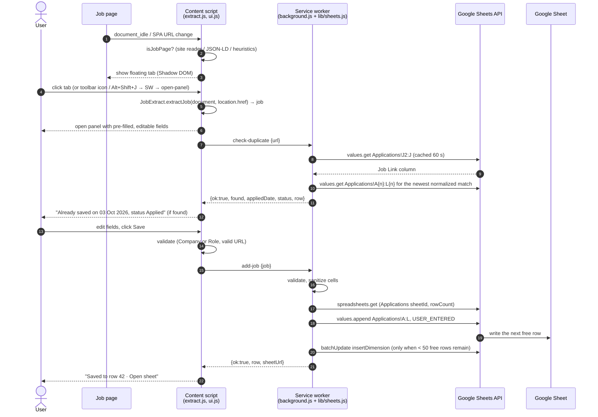
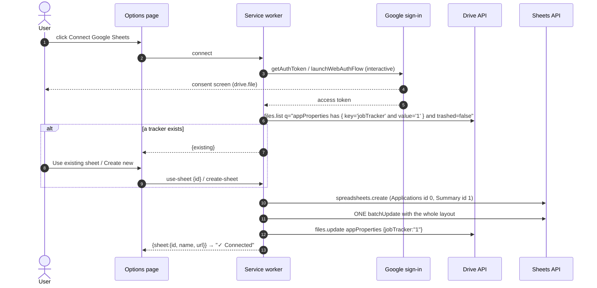

# Architecture

This document describes the design of **Job Application Tracker**. It is a Manifest V3 browser extension that saves the job you just applied to into your own Google Sheet with one click. It is written for developers who want to understand, review or contribute to the project.

## Contents

1. [Overview and assumptions](#1-overview-and-assumptions)
2. [Request flow](#2-request-flow)
3. [Folder structure](#3-folder-structure)
4. [Sheet data model](#4-sheet-data-model)
5. [Message contracts](#5-message-contracts)
6. [Google API contract](#6-google-api-contract)
7. [Extraction strategy](#7-extraction-strategy)
8. [Security and privacy](#8-security-and-privacy)
9. [Testing strategy](#9-testing-strategy)
10. [Milestone roadmap](#10-milestone-roadmap)

---

## 1. Overview and assumptions

### What it does

- On a page detected as a job posting, a small floating tab appears on the right edge of the screen.
- Clicking the tab opens a side panel. Every field is pre-filled from the page and can be edited.
- The user clicks **Save**, and a row is appended to their Google Sheet.
- The toolbar icon and **Alt+Shift+J** open the same panel on any page, even where auto-detection missed it.
- A small **×** on the floating tab hides it for that site.
- A setting chooses when the tab shows: `auto` (job pages only, the default), `always` or `never`.
- Setup is one button: **Connect Google Sheets** signs in with Google and creates a fully formatted tracker spreadsheet in the user's Drive.

### Moving parts

| Part | Runs in | Responsibility |
|---|---|---|
| Content scripts | Every http/https page (isolated world) | Detect job pages, extract fields, render the button and panel in Shadow DOM |
| Service worker | Extension background | Message router, toolbar/shortcut handling, first-run options page, daily upkeep alarm |
| `lib/sheets.js` | Loaded into the service worker | Google sign-in, every Sheets and Drive REST call, the sheet layout, duplicate lookup, the upkeep logic |
| Options page | Extension page | Connect / choose / disconnect, upkeep settings, button mode, hidden sites, current shortcut |
| Google Sheet | User's Drive | The data. The Summary tab is built from formulas only |

### Assumptions

- **One user, one sheet, no backend.** The extension calls Google's APIs directly with the user's own OAuth token. The project runs no server.
- **Scope `drive.file` only.** The extension can see only files it created (or that the user opened with it). It never requests the full `spreadsheets` or `drive` scopes.
- **No build step.** The extension is plain JavaScript and runs in Chrome, Edge or Brave (Chromium 116+). It uses no frameworks, bundlers or transpilers. The service worker is a classic script that pulls in `config.js` and `lib/sheets.js` with `importScripts`.
- **Deterministic extraction only.** It uses no LLM or AI APIs. Every value comes from selectors, structured data or regular expressions, so the same page always gives the same result.
- **English-first heuristics.** YOE, work-mode and salary patterns target English job posts. Site readers and JSON-LD work for any language.
- **Background work needs the browser.** Auto-Ghosted and *Last Updated* after manual edits run from a `chrome.alarms` alarm, so they happen only while the browser is open and catch up shortly after it starts.

---

## 2. Request flow

### Saving a job



### Connecting



The service worker makes every network call. Content scripts run under the page's origin rules and would hit CORS, and only the worker holds the OAuth token.

---

## 3. Folder structure

```
.
├── extension/                 # load this folder unpacked
│   ├── manifest.json
│   ├── config.js              # OAuth client IDs (Chrome Extension client + Web application client)
│   ├── background.js          # service worker: router, commands, action click, onInstalled, alarms
│   ├── lib/
│   │   └── sheets.js          # sign-in, Sheets/Drive REST, sheet layout, lookup, upkeep
│   ├── content/
│   │   ├── extract.js         # pure logic: site readers, JSON-LD, heuristics, field parsers, canonicalUrl, source map
│   │   └── ui.js              # Shadow DOM button + panel, SPA watcher, messaging
│   ├── options/
│   │   ├── options.html
│   │   └── options.js
│   └── icons/                 # 16, 32, 48, 128 px PNG (generated by scripts/make-icons.js)
├── scripts/
│   └── make-icons.js          # regenerates extension/icons with Node's zlib (npm run icons)
├── tests/
│   ├── fixtures/              # synthetic HTML per site + jsonld-only + plain-career page
│   ├── fields.test.js         # YOE, work mode, salary, canonical URL, source map
│   ├── extract.test.js        # fixture-driven end-to-end extraction, including edge cases
│   ├── ui.test.js             # ui.js in jsdom: panel flow, key/focus isolation, single instance, detection budget
│   ├── options.test.js        # options page in jsdom: connect states, legacy notice, upkeep settings
│   ├── sheets.test.js         # lib/sheets.js in node:vm: request bodies, append, lookup, auth, upkeep
│   └── background.test.js     # background.js in node:vm: routing, errors, connect flow, toolbar, alarm
├── docs/
│   ├── ARCHITECTURE.md
│   ├── GOOGLE_CLOUD_SETUP.md  # OAuth clients, consent screen, manifest key
│   ├── PUBLISHING.md          # Chrome Web Store submission
│   └── TESTING.md             # manual QA checklist for a real browser and sheet
├── PRIVACY.md
├── package.json               # "test": "node --test"; devDependencies: jsdom only
├── README.md
└── LICENSE
```

### Module loading without a build step

`extract.js` uses a small UMD wrapper. Chrome loads it as a content script that sets a global in the extension's isolated world, and Node loads it with `require` for tests:

```js
(function (root, factory) {
  const api = factory();
  if (typeof module === 'object' && module.exports) module.exports = api;
  else root.JobExtract = api;
})(globalThis, function () { /* … */ return { extractJob, isLikelyJobPage, /* … */ }; });
```

The public API is `JobExtract = { extractJob, isLikelyJobPage, canonicalUrl, extractYOE, workModeFrom, salaryFromText }`, plus `sourceFromHost`, `readJsonLdPostings` and `SOURCE_NAMES` for the UI and tests. The site readers live inside `extract.js` as a plain array, so the whole extraction pipeline is one file with no load-order coupling. The manifest loads `extract.js` before `ui.js`.

The service worker starts with `importScripts('config.js', 'lib/sheets.js')`. Both are plain scripts whose top-level functions and constants become worker globals; the tests load them into a `node:vm` context the same way.

### Manifest essentials

```jsonc
{
  "manifest_version": 3,
  "permissions": ["storage", "activeTab", "scripting", "identity", "alarms"],
  "host_permissions": ["https://sheets.googleapis.com/*", "https://www.googleapis.com/*"],
  "oauth2": {
    "client_id": "<Chrome Extension client ID>.apps.googleusercontent.com",
    "scopes": ["https://www.googleapis.com/auth/drive.file"]
  },
  // optional "key": "<base64 public key>" pins the extension ID (docs/GOOGLE_CLOUD_SETUP.md)
  "background": { "service_worker": "background.js" },
  "action": { "default_title": "Save this job to your sheet (Alt+Shift+J)" },
  "commands": { "_execute_action": { "suggested_key": { "default": "Alt+Shift+J" } } },
  "options_ui": { "page": "options/options.html", "open_in_tab": true },
  "content_scripts": [{
    "matches": ["http://*/*", "https://*/*"],
    "js": ["content/extract.js", "content/ui.js"],
    "run_at": "document_idle"
  }]
}
```

---

## 4. Sheet data model

### `Applications` tab

The header is in row 1, which is frozen. Data starts at row 2. `createTrackerSpreadsheet()` creates the tab with 1,001 rows and pre-formats the 1,000 data rows (plain-text columns, date formats, dropdowns, status colors), and a filter covers all of them. When fewer than 50 empty rows remain after a save, `appendJob` inserts 500 more with `insertDimension` and `inheritFromBefore: true`, just below the row it wrote. The new rows sit inside every formatted range, so they inherit the number formats and the dropdowns, colors and filter stretch over them.

| # | Column | Stored as | Format / validation | Set by |
|---|---|---|---|---|
| A | Company | Text | `@` plain text | Panel |
| B | Role | Text | `@` | Panel |
| C | Applied Date | Date | `dd mmm yyyy` | Panel (defaults to today). Sent as `YYYY-MM-DD` with `USER_ENTERED`, which Sheets parses as a date |
| D | Status | Text | Dropdown (strict): Saved, Applied, OA / Assessment, Interview, Offer, Rejected, Ghosted, Withdrawn | Panel (default `Applied`) |
| E | Work Mode | Text | Dropdown (strict): On-site, Remote, Hybrid, N/A | Panel |
| F | Location | Text | `@` | Panel |
| G | YOE | Text | `@` so `2-5` never becomes a date | Panel (`3+ yrs`, `2-5 yrs`, `Fresher`, `N/A`) |
| H | Salary / CTC | Text | `@` | Panel (blank if none found) |
| I | Source | Text | `@` | Panel (from hostname, editable) |
| J | Job Link | Text | `@` | Panel (canonical URL). Used for duplicate checks |
| K | Last Updated | Date | `dd mmm yyyy` | `appendJob` on save; the daily upkeep after a Status change and when ghosting |
| L | Notes | Text | `@` | Panel |

Every text column is formatted `@`. This is plain-text formatting, so Sheets never turns values like `2-5`, `10-12` or `1/2` into dates or numbers. Column widths are set so Company, Role and Notes are wide, and the date and dropdown columns are narrow.

### Status colors (conditional formatting on `D2:D`)

| Status | Background | Text |
|---|---|---|
| Saved | `#f1f3f4` light grey | `#3c4043` |
| Applied | `#d2e3fc` blue | `#174ea6` |
| OA / Assessment | `#e9d7fe` purple | `#5b2c98` |
| Interview | `#feefc3` amber | `#8a5a00` |
| Offer | `#ceead6` green | `#0d652d` |
| Rejected | `#fad2cf` red | `#a50e0e` |
| Ghosted | `#5f6368` dark grey | `#ffffff` |
| Withdrawn | `#e6d5c3` brown | `#6d4c2f` |

### Automation (daily upkeep)

Google Apps Script could react to edits and run on a timer inside Google. Without it, both features run in the service worker from a `chrome.alarms` alarm named `daily-upkeep`:

- **Scheduling.** `runtime.onInstalled` and `runtime.onStartup` (re-)create the alarm with `delayInMinutes: 1, periodInMinutes: 1440`. Chrome may drop alarms on restart, so re-creating it on every start is what guarantees the catch-up run about a minute after the browser opens. It then runs once a day while the browser is open.
- **One read, one write.** `runUpkeep()` reads `Applications!A2:L` with `valueRenderOption=UNFORMATTED_VALUE` and `dateTimeRenderOption=SERIAL_NUMBER`. The pure function `planUpkeep(rows, snapshot, settings)` decides the changes, and they go out in one `values.batchUpdate` (`USER_ENTERED`, ISO dates).
- **Last Updated after a manual Status change.** `chrome.storage.local.statusSnapshot` maps each Job Link to the Status seen on the previous run (a link saved twice gets a second key, `<link> #2`). A row whose Status differs from its snapshot entry, and isn't blank, gets K = today. `appendJob` adds an entry for every saved row, so a change made before the next run is still noticed. The snapshot is rebuilt from the current rows on every run (deleted rows drop out) and saved only after the write succeeds, so a failed run is retried in full.
- **Auto-Ghosted.** When enabled (`autoGhost`, on by default), rows with status `Applied` or `OA / Assessment` whose Last Updated (or Applied Date when K is blank) is more than `ghostAfterDays` (default 30) days old become `Ghosted`, and K is set to today. A row whose Status was just changed by hand is not ghosted in the same run. Rows with no usable date are left alone.
- Errors (not connected, signed out, offline) are logged and skipped; the next run tries again.

### `Summary` tab (formulas only, written by `createTrackerSpreadsheet()`)

`D` means `Applications!D2:D` and `C` means `Applications!C2:C`.

| Metric | Formula (sketch) |
|---|---|
| Total applications | `=COUNTA(D) - COUNTIF(D,"Saved")` |
| Applied, last 7 days | `=COUNTIFS(C,">="&(TODAY()-7), D,"<>Saved")` |
| Applied, last 30 days | `=COUNTIFS(C,">="&(TODAY()-30), D,"<>Saved")` |
| Response rate | `=IFERROR((COUNTIF(D,"OA / Assessment")+COUNTIF(D,"Interview")+COUNTIF(D,"Offer")+COUNTIF(D,"Rejected")) / Total, 0)` as `%` |
| Interview rate | `=IFERROR((COUNTIF(D,"Interview")+COUNTIF(D,"Offer")) / Total, 0)` as `%` |
| Offers | `=COUNTIF(D,"Offer")` |
| Per status | One row per status: `=COUNTIF(D,status)` and share `=count / COUNTA(D)` |
| Per source | `=IFERROR(QUERY(Applications!A2:L,"select I, count(I) where I <> '' group by I order by count(I) desc label I '', count(I) ''",0),"")` (QUERY returns `#N/A` on an empty sheet) |

Status is a single current value, so an application that went Interview → Rejected counts as Rejected. The interview rate is therefore a lower bound. Tracking status history would need a history column or a separate tab, and that is out of scope for v1.

---

## 5. Message contracts

All messages use `chrome.runtime.sendMessage` or `chrome.tabs.sendMessage` with a kebab-case `type` field. The service worker's router returns `true` so it can reply asynchronously through `sendResponse`. Every failure reply from the service worker has the shape `{ ok:false, error:Code, message:string, detail:string }`. `message` is the friendly text from §6, shared by the panel and the options page; `detail` is Google's own error text (the options page appends it), or for `BAD_REQUEST` the validation problem, which is also part of `message`.

### Job object

```ts
type Job = {
  company: string;      // Company or Role must be non-empty
  role: string;
  appliedDate: string;  // "YYYY-MM-DD" from <input type="date">
  status: "Saved" | "Applied" | "OA / Assessment" | "Interview" | "Offer" | "Rejected" | "Ghosted" | "Withdrawn";
  workMode: "On-site" | "Remote" | "Hybrid" | "N/A";
  location: string;
  yoe: string;          // "3+ yrs" | "2-5 yrs" | "Fresher" | "N/A"
  salary: string;
  source: string;       // "LinkedIn" … | "Company Site"
  url: string;          // canonical, must parse as http(s) URL
  notes: string;
};
type Sheet = { id: string; name: string; url: string };  // url: https://docs.google.com/spreadsheets/d/<id>/edit
```

### Content script → service worker

These never show a consent screen: they use a silent token and report `SIGNED_OUT` when none is available.

| `type` | Payload | Response |
|---|---|---|
| `add-job` | `{ job: Job }` | `{ ok:true, row:number, sheetUrl:string }` or a failure |
| `check-duplicate` | `{ url: string }` (canonical) | `{ ok:true, found:false }` or `{ ok:true, found:true, row, appliedDate:"03 Oct 2026", status }` or a failure |
| `open-options` | none | Opens the options page (content scripts can't call `runtime.openOptionsPage`) |

### Options page → service worker

| `type` | Payload | Response |
|---|---|---|
| `status` | none | `{ ok:true, connected:false }`, `{ ok:true, connected:true, sheet:Sheet }` or a failure (`SHEET_GONE` when the file was deleted, trashed or unshared) |
| `connect` | none | Interactive sign-in, then `{ ok:true, existing:Sheet }` when a tagged tracker exists, otherwise creates one and returns `{ ok:true, sheet:Sheet }` |
| `use-sheet` | `{ id }` | `{ ok:true, sheet:Sheet }` |
| `create-sheet` | none | `{ ok:true, sheet:Sheet }` |
| `disconnect` | none | Revokes the token, clears the stored sheet ID, snapshot and caches. `{ ok:true }` |

Connecting stores the sheet ID and removes the old Apps Script settings (`webAppUrl`, `secret`) from `chrome.storage.sync`.

### Service worker → content script

| `type` | Sent when | Effect |
|---|---|---|
| `open-panel` | `chrome.action.onClicked` (also fired by the `_execute_action` command, Alt+Shift+J) | Re-extract and open the panel. This works even when the page is not detected as a job page, the site is hidden, or the mode is `never`. |

If no sheet is connected yet, the toolbar click opens the options page instead. If `tabs.sendMessage` fails because no content script is in the tab (the tab was open before install, or the extension was updated), the worker injects both content files with `chrome.scripting.executeScript`. The `activeTab` grant from the click or shortcut covers this. It then retries the message once. On pages where injection is forbidden (`chrome://` pages, the Web Store, `file://` without file access, the PDF viewer) the worker shows a red **!** badge on the icon for that tab, with a tooltip that explains why. Chrome clears per-tab badges when the tab navigates.

**One live content script per page.** The injection fallback can race the manifest's own `document_idle` injection, and reloading the extension leaves an orphaned copy behind. On start, `ui.js` dispatches a cancelable `job-tracker-ext:hello` event on `document`. Every running copy listens for it: a live copy cancels it, which tells the newcomer to stop, and an orphaned copy (`chrome.runtime.id` is gone) tears itself down. Only then does the newcomer remove any leftover host element and mount.

### Storage

| Area | Key | Type | Default | Written by |
|---|---|---|---|---|
| `sync` | `buttonMode` | `"auto" \| "always" \| "never"` | `"auto"` | Options |
| `sync` | `hiddenSites` | string[] (hostnames) | `[]` | Content (× on button), Options (remove) |
| `sync` | `autoGhost` | boolean | `true` | Options |
| `sync` | `ghostAfterDays` | integer 1–365 | `30` | Options |
| `local` | `spreadsheetId` | string | none | Service worker on connect; removed on disconnect |
| `local` | `statusSnapshot` | `{ [jobLink]: status }` | `{}` | Service worker (save, daily upkeep) |
| `session` | `webToken` | `{ token, expiresAt }` | none | Web-flow sign-in (Edge, Brave, …) |
| `session` | `linkCache` | `{ id, links, at }` | none | Duplicate lookup, 60 s |

The sheet ID is per device (`local`), because sign-in is per browser profile. Connecting on a second computer finds the same tracker through its Drive tag and offers **Use existing sheet**. Content scripts read the sync settings directly and listen to `chrome.storage.onChanged`, so changes apply to open tabs right away. On `runtime.onInstalled` with `reason === "install"`, the worker calls `chrome.runtime.openOptionsPage()`. If the old `webAppUrl` or `secret` settings are found, the options page shows a one-time notice asking the user to click **Connect Google Sheets** and deletes them.

---

## 6. Google API contract

### Sign-in

- **Google Chrome** (`navigator.userAgentData.brands` contains "Google Chrome"): `chrome.identity.getAuthToken({ interactive, scopes: [drive.file] })` with the **Chrome Extension** OAuth client from `manifest.json` → `oauth2.client_id`. Chrome caches and refreshes the token.
- **Edge, Brave and other Chromium browsers**, where `getAuthToken` is unavailable: `chrome.identity.launchWebAuthFlow` with the OAuth implicit flow (`response_type=token`) against the **Web application** client in `config.js`, redirecting to `chrome.identity.getRedirectURL()` = `https://<extension-id>.chromiumapp.org/`. The token (about one hour) is cached in `chrome.storage.session`. The silent attempt adds `prompt=none`.
- **Silent first.** Every call uses a non-interactive token. Only the options page's **Connect** (a click) signs in interactively.
- **401 → retry once.** On a 401 the cached token is removed (`removeCachedAuthToken`, or the session entry) and the request is retried once with a fresh silent token. A second 401 is `SIGNED_OUT`.
- **Disconnect** posts the token to `https://oauth2.googleapis.com/revoke` (`mode: "no-cors"`, so no host permission is needed and the reply is ignored), then clears every cached token, the stored sheet ID, the snapshot and the caches.

### Requests (`lib/sheets.js`)

All requests send `Authorization: Bearer <token>` and time out after 20 s.

| Function | Request |
|---|---|
| `createTrackerSpreadsheet()` | `POST sheets/v4/spreadsheets` with title "Job Applications Tracker", tabs Applications (`sheetId` 0, 1,001 × 12) and Summary (`sheetId` 1). Then **one** `:batchUpdate` with `setupRequests()`: header cells and style, frozen row, row height, column widths, `TEXT` and `DATE dd mmm yyyy` number formats, two `ONE_OF_LIST` validations (strict), eight `TEXT_EQ` conditional-format rules, `setBasicFilter`, and the Summary cells, formats and widths. Then `PATCH drive/v3/files/<id>` with `appProperties: { jobTracker: "1" }` |
| `findExistingTracker()` | `GET drive/v3/files?q=appProperties has { key='jobTracker' and value='1' } and trashed=false&orderBy=modifiedTime desc` |
| `getTrackerInfo(id)` | `GET drive/v3/files/<id>?fields=id,name,trashed` |
| `appendJob(job)` | `GET spreadsheets/<id>?fields=sheets.properties(sheetId,title,gridProperties.rowCount)`, then `POST values/Applications!A:L:append?valueInputOption=USER_ENTERED&insertDataOption=OVERWRITE`, then (when the sheet is nearly full) `:batchUpdate` with one `insertDimension` |
| `findByLink(url)` | `GET values/Applications!J2:J` (cached 60 s in `chrome.storage.session`), then `GET values/Applications!A<n>:L<n>` for the match |
| `runUpkeep(settings)` | `GET values/Applications!A2:L?valueRenderOption=UNFORMATTED_VALUE&dateTimeRenderOption=SERIAL_NUMBER`, then `POST values:batchUpdate` when something changed |

Drive `appProperties` are private to the Google Cloud project that set them, so only this extension can tag or find its trackers, and both OAuth clients must live in the same project.

### Error codes

| Code | Raised by | Meaning | Friendly message in panel/options |
|---|---|---|---|
| `NOT_CONNECTED` | Sheets layer | No sheet ID stored yet | "Connect Google Sheets in Settings first." |
| `SIGNED_OUT` | Sheets layer | No token could be obtained silently, the user cancelled the consent screen, or Google answered 401 twice | "Google sign-in is needed. Open Settings and click Connect Google Sheets." |
| `SHEET_GONE` | Sheets layer | Google answered 403 or 404, or the file is in the trash: the sheet was deleted or access was removed | "Can't open your tracker sheet. It may have been deleted, or access was removed. Open Settings and click Reconnect." |
| `SETUP_REQUIRED` | Sheets layer | The spreadsheet has no `Applications` tab | "Your tracker sheet has no "Applications" tab. Rename it back, or open Settings and click Reconnect to create a new sheet." |
| `BUSY` | Sheets layer | HTTP 429 (quota) | "Google Sheets is busy. Try again in a moment." |
| `NETWORK` | Sheets layer | fetch failed or the 20 s timeout was reached | "Couldn't reach Google. Check your connection and try again." |
| `GOOGLE_ERROR` | Sheets layer | Any other non-OK reply, or an append reply without a row | "Google Sheets returned an error. Try again in a moment." |
| `BAD_REQUEST` | Sheets layer | Missing job, neither company nor role, invalid URL, or an invalid sheet ID | "The job data was rejected. <detail>" |
| `INTERNAL` | Service worker | Any other exception | "Something went wrong in the extension. Try again." |
| `RELOADED` | Content script | The extension was reloaded or updated, so this page's content script can no longer reach the service worker | "The extension was updated. Reload this page and try again." |

### Row rules

- **Validation.** Company or Role must be present. `url` must parse as http(s). `status` and `workMode` are coerced to allowed values, with defaults `Applied` and `N/A`. Field lengths are capped at 5,000 characters, well under the 50,000-character limit for a cell.
- **Applied Date.** Accepted only as a real `YYYY-MM-DD` calendar date; anything else becomes today in the browser's time zone.
- **Formula-injection guard.** Because rows are written with `USER_ENTERED`, any string cell that starts with `=`, `+`, `-`, `@`, tab or CR is prefixed with `'`. This applies to every text field, including Notes.
- **YOE stays text.** The YOE column has the plain-text number format, so `2-5 yrs` or `10-12` never become dates.
- **Duplicate lookup.** Both the requested link and every Job Link cell are normalized (lower-cased, no scheme, `www.`, `#hash`, Workday locale, tracking parameters, `/apply` or trailing slash; remaining parameters sorted) and compared, newest row first. Links typed by hand still match.
- **Concurrency.** Apps Script's lock is gone. `values.append` is atomic on Google's side, and one user saving from one browser doesn't race in practice.

---

## 7. Extraction strategy

### Layers

For every field, the extractor tries three layers in order and takes the **first non-empty value**:

1. **Site reader.** It is chosen by hostname from the `SITE_READERS` array in `extract.js`. Each reader is `{ name, matches(host), isJobPage(doc, url), read(doc, url) }`, and `read` uses shared helpers (`pick(...selectors)`, `pickAll`, `pickAttr`, `labelValue(labels)`). Each field lists several fallback selectors, in this order of preference:
   1. Stable attributes: `data-testid`, `data-automation-id`, `data-test`, `data-qa`, `itemprop`, `id`
   2. Semantic structure (`h1`, `[role=heading]`)
   3. Substring class matches for hashed CSS-module classes, such as `[class*="jd-header-title"]`
   4. Full class names, used last

   Location selectors on Naukri and Workday use `pickPlaces`, which joins several links or list items inside the match with `; ` (`Pune; Mumbai; Bengaluru`), so multi-city postings don't run together.

   Readers exist for LinkedIn, Naukri, Indeed, Glassdoor, Greenhouse, Lever, Workday (`myworkdayjobs.com`, `myworkdaysite.com`) and Ashby. Readers also derive a `companyFallback` from the URL where the platform encodes it: the Greenhouse/Lever/Ashby path slug and the Workday tenant. A slug like `acmerobotics` is a poor display name, so the fallback is used only after the JSON-LD company: the order for Company is site reader → JSON-LD → URL fallback → generic.
2. **schema.org `JobPosting` JSON-LD.** See below.
3. **Generic heuristics.** See below.

`extractJob(doc, url)` returns a `Job` object (§5) with every field filled, `status: "Applied"`, today's date and empty notes. `isLikelyJobPage(doc, url)` is the separate, cheaper check used for the floating button.

### Initial site-reader targets

These are starting points. The fixtures pin them, and when a site changes its DOM the reader and its fixture are updated together.

| Site | Role | Company | Location / work mode | Description / extra |
|---|---|---|---|---|
| LinkedIn | top-card `h1` (`[class*="top-card__job-title"]`) | top-card company link | top-card tertiary text; workplace-type pill | `#job-details`, `.jobs-description__content` |
| Naukri | `[class*="jd-header-title"]` | `[class*="jd-header-comp-name"] a` | `[class*="location"]` | `[class*="salary"]`, `[class*="exp"]` (YOE), `[class*="job-desc"]` |
| Indeed | `[data-testid="jobsearch-JobInfoHeader-title"]` | `[data-testid="inlineHeader-companyName"]` | `[data-testid="inlineHeader-companyLocation"]`, `[data-testid="job-location"]` | `#jobDescriptionText`, `#salaryInfoAndJobType` |
| Glassdoor | `[data-test="job-title"]` | `[data-test="employer-name"]` | `[data-test="location"]` | `[data-test="detailSalary"]`, `[class*="jobDescription"]` |
| Greenhouse | `h1`, `.app-title` | path slug, `.company-name` | `.location`, `.job__location` | `#content`, `.job__description` |
| Lever | `.posting-headline h2` | path slug | `.posting-categories .location`, `.workplaceTypes` | `[data-qa="job-description"]`, `.section-wrapper` |
| Workday | `[data-automation-id="jobPostingHeader"]` | subdomain | `[data-automation-id="locations"]`, `[data-automation-id="remoteType"]` | `[data-automation-id="jobPostingDescription"]` |
| Ashby | `h1` | path slug | "Location" / "Location Type" label values | JSON-LD (Ashby ships it), `[class*="descriptionText"]` |

### JSON-LD layer

- Read every `script[type="application/ld+json"]`. Parse with `JSON.parse`. If that fails, strip HTML-comment and CDATA wrappers, replace raw control characters (such as newlines inside strings) with spaces and drop trailing commas, then retry once. Ignore the block if it still fails.
- Flatten top-level arrays, `@graph` and `mainEntity`, and match objects whose `@type` is or includes `JobPosting`.
- Mapping:
  - `title` → role
  - `hiringOrganization.name` (or a string) → company
  - `jobLocation[].address` → `addressLocality, addressRegion, addressCountry` → location. Several locations are joined with `; `
  - `jobLocationType === "TELECOMMUTE"` → Remote. `applicantLocationRequirements` names are added to the location ("Remote – India").
  - `baseSalary` / `estimatedSalary` → salary (see below)
  - `experienceRequirements.monthsOfExperience` → `⌊m/12⌋+ yrs`. Text or `description` → YOE parser
  - `description` (HTML stripped) → description text for the YOE, work-mode and salary parsers
- **Stale-data guard for SPAs.** If the site reader found the visible role, only a posting whose normalized title contains it, is contained by it, or shares at least 50 % of its words is used. Otherwise all JSON-LD is ignored, because it belongs to a previously viewed job. The guard is keyed to site readers only: on generic pages the `h1` is often a company or careers heading, and comparing against it would throw away good JSON-LD.

### Generic heuristics layer

- **Role** comes from `h1`, then `og:title`, then `document.title`, split on these patterns:
  - `Role at Company`
  - `Job Application for Role at Company`
  - `Role | Company` or `Role - Company` (the side that looks like a company is dropped)
- **Company** comes from `og:site_name`, then the company part of the title pattern, then the hostname. For the hostname, drop `www`, `careers`, `jobs`, `apply`, `boards` and `talent` subdomains plus the TLD, then title-case the rest (`careers.acme.com` → `Acme`).
- **Location** comes from `[itemprop=jobLocation]`, then elements whose `class`, `id` or `data-*` contain `location`, then the text after a `Location:` label.
- **Description** is the longest text block among `[itemprop=description]`, `[class*=description]`, `[id*=description]`, `[class*=job-details]`, `article` and `main`. It is capped at 50 k characters for parsing.

### Field rules

**YOE** (`extractYOE(text, { requireContext = true }) → string`)

- Normalize the text first: NBSP becomes a space, en/em dashes become `-`, and the text is lower-cased.
- Patterns:
  - Ranges: `2-5 years`, `3 to 5 yrs`
  - Plus forms: `5+ years`
  - Minimums: `at least 3 years`, `minimum of 4 yrs`, `min. 2 years`
  - Plain forms: `3 years of experience`
  - Number words: `three (3) years`, `five years`, from one to twenty
- All candidate matches from all patterns are collected with their index. **The earliest valid match wins.**
- A match is valid only if all of these hold:
  - `experience` or `exp` appears within about 90 characters around it. Site fields that are already about experience (Naukri's experience chip, JSON-LD `experienceRequirements`) pass `requireContext: false`.
  - No number is above 30.
  - In a range, min < max. A number right after a dash is never read on its own, so `5-3 years` gives nothing rather than `3 yrs`.
  - It is not followed by `old`, `ago` or `of age`.
- Output: `2-5 yrs`, `5+ yrs` (plus and minimum forms both become `N+ yrs`), `3 yrs`.
- If nothing matches but the text contains `fresher`, `entry level`, `new grad` or `recent graduate`, the result is `Fresher`. Otherwise it is `N/A`.

**Work mode** (`workModeFrom({ explicit, location, header, description })`; a plain string is treated as location text)

1. Explicit fields: JSON-LD `jobLocationType`, the LinkedIn workplace-type pill, Lever `workplaceTypes`, Workday `remoteType`.
2. Loose match on location and header text: `hybrid`, `remote` / `work from home` / `wfh`, `on-site` / `onsite` / `in office` / `work from office` / `wfo`.
3. Strict phrases in the description:
   - Hybrid: `hybrid` (excluding `hybrid cloud`, `hybrid app` and `hybrid mobile`)
   - Remote: `fully remote`, `100% remote`, `remote-first`, `remote position`, `remote role`, `work from home`
   - On-site: `work from office`, `on-site role`, `in-office`
   - Phrases such as "remote teams" do not count.

Within a layer, **Hybrid > Remote > On-site**. If nothing matches, the result is `N/A`.

**Salary**

1. JSON-LD `baseSalary` or `estimatedSalary` (`{currency, value:{minValue,maxValue,value,unitText}}`). INR yearly amounts of 1 lakh or more are shown as `12-18 LPA`. Others are shown as `USD 120,000-150,000 / year`.
2. Site fields: Naukri salary, the Indeed salary pill, the Glassdoor estimate. Values matching `not disclosed`, `competitive` or `as per industry` are ignored.
3. Description (`salaryFromText(text)`): only amounts within about 60 characters of `salary`, `ctc`, `compensation`, `pay`, `package`, `stipend` or `lpa`.
   - Currencies: `₹`, `Rs.`, `INR`, `$`, `USD`, `€`, `£`
   - Units: `k`, `L`, `lakh`, `LPA`, `Cr`
   - Ranges: `12-18 LPA`, `₹ 8,00,000 - 12,00,000`
   - The matched snippet is returned trimmed. If nothing matches, the result is blank.

**Canonical URL** (`canonicalUrl(href)`)

- LinkedIn: `/jobs/view/<slug>-<id>`, `/jobs/view/<id>` and any page with `currentJobId=<id>` become `https://www.linkedin.com/jobs/view/<id>`.
- Indeed: `jk` or `vjk` becomes `https://<same host>/viewjob?jk=<id>`. The host is kept because Indeed uses a country domain.
- Workday: the locale prefix (`/en-US/`, `/de-DE/`, …) is removed, because the same job is served under every locale.
- Naukri, Workday, Lever, Ashby and Greenhouse job-board pages (`/jobs/<id>`): the whole query string is dropped, because the path identifies the job and the query only holds search or session state (Naukri's `sid` changes on every search).
- Everywhere:
  - Lower-case the host, drop the default port and drop the `#hash`.
  - Remove tracking parameters: `utm_*`, `ref`, `refId`, `ref_src`, `referrer`, `trk`, `trkInfo`, `trackingId`, `gh_src`, `lever-source`, `lever-origin`, `fbclid`, `gclid`, `dclid`, `msclkid`, `yclid`, `mc_cid`, `mc_eid`, `_hsenc`, `_hsmi` and `igshid`.
  - Sort the remaining parameters.
  - Strip a trailing `/apply` and the trailing `/`.
  - `gh_jid` is **kept**, because it identifies the job on company-hosted Greenhouse embeds.

**Source** (`sourceFromHost(hostname)`). The hostname matches if it equals the domain or ends with `.domain`. Indeed and Glassdoor match on any TLD.

| Host | Source | Host | Source |
|---|---|---|---|
| linkedin.com | LinkedIn | icims.com | iCIMS |
| naukri.com | Naukri | wellfound.com, angel.co | Wellfound |
| indeed.* | Indeed | instahyre.com | Instahyre |
| glassdoor.* | Glassdoor | foundit.in, foundit.sg | Foundit |
| myworkdayjobs.com, myworkdaysite.com | Workday | cutshort.io | Cutshort |
| greenhouse.io | Greenhouse | hirist.tech, hirist.com | Hirist |
| lever.co | Lever | internshala.com | Internshala |
| ashbyhq.com | Ashby | taleo.net | Taleo |
| smartrecruiters.com | SmartRecruiters | successfactors.com, successfactors.eu | SuccessFactors |
| oraclecloud.com | Oracle Cloud | bamboohr.com | BambooHR |
| workable.com | Workable | recruitee.com | Recruitee |
| jobvite.com | Jobvite | teamtailor.com | Teamtailor |
| zohorecruit.com, zohorecruit.in | Zoho Recruit | *anything else* | Company Site |

### Job-page detection (`auto` mode)

A page counts as a job page if any of these is true:

- A site reader's `isJobPage` is true, for example LinkedIn `/jobs/view/` or `currentJobId`, Indeed `jk`/`vjk`, or a Workday `/job/` path.
- JSON-LD contains a `JobPosting`.
- The URL has a `gh_jid=<number>` parameter: a Greenhouse board embedded on a company site. The job itself is inside Greenhouse's cross-origin iframe, so only the page title, company and link can be read; Role is often left for the user to fill in.
- **Generic** (only for hosts without a site reader): the URL path or query matches `job|career|position|opening|vacanc|requisition|posting`, a heading (`h1`, `h2` or `[role=heading]`) exists, and the page text contains at least two of `responsibilit`, `requirement`, `qualification`, `experience` and `apply`.

For hosts with a site reader, the reader's answer is final. LinkedIn's feed, for example, is never treated as a job page by the generic rule.

Detection is cheap: no description parsing and no regex over the full body unless the generic URL test passes first.

### Single-page apps (LinkedIn, Workday, Indeed)

- One `MutationObserver` on `document.documentElement` (`childList`, `subtree`), plus `popstate` and `hashchange`, schedules detection. It is debounced to 500 ms but never postponed by more than 2 s, so pages that mutate constantly still get checked. The same check re-attaches the UI host if a SPA wiped it from the DOM.
- Detection is budgeted. It runs only in `auto` mode on a site that isn't hidden (`always` and `never` need no detection). A URL already known to be a job page is not checked again, and any one URL is checked at most 10 times, which covers a slow SPA rendering its content; a new URL resets the budget. The first check waits until the settings have loaded.
- If the extension is reloaded, the old content script is orphaned (`chrome.runtime.id` becomes undefined). It notices on its next check and removes itself. A freshly injected copy also removes any leftover host element by id.
- **Full extraction runs on every panel open, with no caching.** This means the panel never shows data from the previously viewed job. The stale JSON-LD guard above covers frameworks that leave old `<script type="application/ld+json">` tags in the DOM.

### Panel UI

- The host element is a `<div>` appended to `documentElement` with `all: initial`. Its shadow root is **closed**, and its styles live inside the shadow root, so page CSS can't leak in.
- The floating tab sits on the right edge. Its "Save job" label slides out on hover or focus, and a small **×** on its corner hides it for the current hostname.
- The panel holds `Company`, `Role`, `Applied Date` (`<input type=date>`), `Status` (`<select>` with a colored dot that matches the sheet colors), `Work Mode` (`<select>`), `Location`, `YOE`, `Salary / CTC`, `Source` (`<input>` with a `<datalist>` of known sources plus Referral / Recruiter / Email), `Job Link` and `Notes` (`<textarea>`).
- The template is a static string. Every extracted value is written with `.value` or `.textContent`, never `innerHTML`.
- Changing the Job Link canonicalizes it and re-runs the duplicate check.
- Light and dark themes use `@media (prefers-color-scheme: dark)` inside the shadow CSS. Field borders use a separate token with at least 3:1 contrast against the field and panel backgrounds; text meets 4.5:1.
- The panel spans the viewport height minus 12 px margins, and only the form body scrolls, so it works down to a 320 px tall viewport. The host sits at the end of `<html>` with the maximum `z-index`, so fixed headers and high-`z-index` overlays stay below it. Native modal `<dialog>`s and popovers live in the browser's top layer and can still cover it.
- Focus: opening the panel moves focus to Company; closing it (Esc, ×, Cancel, Done) returns focus to the element that had it before, usually the floating tab.
- Keyboard and focus isolation: events from inside a closed shadow root are retargeted to the host element. A capture-phase listener on `window` calls `stopImmediatePropagation` on `keydown`, `keyup`, `keypress`, `focusin` and `focusout` whose target is the host, so the site's document and element listeners (shortcuts, focus traps) never see them. Typing still works because default actions are not cancelled. The same listener closes the panel on **Esc**. `input`, `beforeinput`, `paste`, `copy` and `cut` are also stopped at the host. Window capture listeners that the page registered *before* ours still run first. That is a platform limit, listed in the QA checklist.
- States:
  - Idle
  - Duplicate warning: a banner reading "Already saved on <date>, status <X>". Saving is still allowed.
  - Saving: the button is disabled and shows a spinner. A reply that arrives after the panel was closed or reopened is ignored.
  - Success: "Saved to row N" with an **Open sheet** link to `sheetUrl`.
  - Error: the friendly message from the table in §6.
- Validation runs before sending: Company or Role is required, and Job Link must parse as an `http(s)` URL. Inline errors are shown on the fields.

---

## 8. Security and privacy

- **Data goes only to the user's own Google account.** The extension makes no analytics calls, no telemetry, no remote config fetches and no third-party requests. The only hosts it calls are `sheets.googleapis.com` and `www.googleapis.com` (Sheets and Drive APIs), `accounts.google.com` through `chrome.identity` for sign-in, and `oauth2.googleapis.com/revoke` on disconnect.
- **Least-privilege OAuth.** The only scope is `drive.file`: the extension can see and change only the files it created. It can't list or read any other file in the user's Drive. The full `spreadsheets` and `drive` scopes are never requested.
- **Tokens.** In Chrome the browser's identity system stores and refreshes tokens. In other browsers the short-lived access token (about one hour) is kept in `chrome.storage.session`, which lives in memory and is never written to disk or synced. No refresh token exists. **Disconnect** revokes the grant.
- **Minimal permissions.**
  - `identity` for sign-in, `storage` for settings and the sheet ID, `alarms` for the daily upkeep.
  - `activeTab` and `scripting` are used for toolbar/shortcut injection on tabs without the content script.
  - `host_permissions` cover only the two Google API hosts.
  - The content scripts on `http://*/*` and `https://*/*` are required to detect jobs on any site. They make Chrome show the "read and change data on all websites" warning, and the README explains why.
- **The content scripts make no network calls** and never see the token. They only read the DOM and message the service worker.
- **Shadow DOM isolation.** A closed shadow root keeps page CSS out and stops page scripts from walking into the panel through `element.shadowRoot`.
- **Formula injection.** The sheets layer prefixes any cell starting with `= + - @`, tab or CR with `'`. The client never builds formulas from page data.
- **Input limits.** Field lengths are capped and enums coerced, so a hostile page can't push huge or invalid values through extracted fields.
- **The sheet ID from `use-sheet`** must match `[\w-]+` and is checked with Drive before it is stored. With `drive.file`, Google itself refuses IDs of files the extension didn't create.
- **Test fixtures are synthetic.** They are minimal hand-written HTML that mimics each site's structure. No real job posts or personal data are committed.

---

## 9. Testing strategy

- **Runner:** Node's built-in `node:test` and `node:assert`. `npm test` runs `node --test`, which finds `tests/**/*.test.js`.
- **Only dev dependency:** `jsdom`, used to build a `document` from fixtures. Each fixture is loaded with the URL of the site it imitates (`new JSDOM(html, { url })`) so hostname-based logic runs as it would in the browser.
- **Unit tests (`fields.test.js`):**
  - YOE: ranges, plus forms, minimums, plain forms, number words, the 90-character `experience` window, values over 30, `years old` / `years ago`, earliest-match-wins and the Fresher fallback.
  - Work mode: priority order, "remote teams" not counting, `hybrid cloud` excluded.
  - Salary: JSON-LD shapes, LPA conversion, the "Not disclosed" filter, the keyword-distance rule.
  - `canonicalUrl`: LinkedIn view/slug/`currentJobId`, Indeed `jk`/`vjk`, tracking-parameter removal, `gh_jid` kept, `/apply` and trailing slash removed.
  - `sourceFromHost`: every mapped host plus the Company Site fallback.
- **Fixture tests (`extract.test.js`):** a table of `{ fixture, url, expected }` covering LinkedIn (including a search page with `currentJobId` and stale JSON-LD), Naukri, Indeed, Glassdoor, Greenhouse, Lever, Workday, Ashby, a **JSON-LD-only** page (malformed JSON inside `@graph`) and a **plain career page** that relies on heuristics only. Each test checks every field and `isLikelyJobPage`. A blog post fixture and LinkedIn's feed URL check that detection stays quiet on non-job pages.
  - Edge-case fixtures: Naukri with a `3-5 Yrs` chip, salary "Not disclosed", several location links, "remote teams" and "Founded 10 years ago" (`naukri-edge`); a Lever job in "Remote (India)" with the YOE in words (`lever-remote`); a Greenhouse embed on a company domain (`greenhouse-embed`); a page with no `h1` and Hybrid only in the description (`no-h1`); a Workday `/de-DE/` page with two locations (`workday-multi`); JSON-LD inside a comment with raw newlines, trailing commas and two locations next to an unrecoverable block (`jsonld-malformed`).
  - LinkedIn search and collection pages with `currentJobId`, and a ~1.2 MB description that must stay fast and respect the 50,000-character parsing cap.
- **Sheets tests (`sheets.test.js`):** `config.js` and `lib/sheets.js` run in `node:vm` with a routed `fetch` mock, `chrome.identity`, `chrome.storage` and `navigator.userAgentData`. They cover:
  - The exact request bodies for create → one batchUpdate → Drive tag: sheet IDs, header, frozen row, widths, dropdown values and strictness, the eight status colors, text and date formats, the filter range, and every Summary formula (including the empty-sheet `IFERROR` around `QUERY`)
  - The `files.list` query
  - Append: `USER_ENTERED`, the formula guard, YOE as text, defaults, validation, the row parsed from `updatedRange`, the `sheetUrl`, and the `insertDimension` top-up
  - Duplicate lookup by normalized link, newest first, with the 60 s cache and cache updates after a save
  - The 401 drop-and-retry-once, and 403/404/429/500/offline/signed-out error codes
  - The `launchWebAuthFlow` fallback outside Google Chrome, with session caching, and revocation on sign-out
  - `planUpkeep` (ghost thresholds, rows without dates, the on/off switch, snapshot-based stamping, links saved twice, cleared statuses) and `runUpkeep` (render options, one batch write, no snapshot update after a failed write)
- **Sync test:** status colors and tracking parameters are duplicated across `lib/sheets.js`, `ui.js` and `extract.js`, and the client ID and scope across `config.js`, `lib/sheets.js` and `manifest.json`. A test compares them so they can't drift apart, and also pins the manifest's permission list.
- **UI tests (`ui.test.js`):** `ui.js` runs in jsdom with a `chrome.*` mock; the closed shadow root is captured by wrapping `attachShadow`. They cover the open/duplicate/validate/save flow, error banners, the Google-Sheets-only link, Esc, key and focus isolation, focus return, late save replies, hiding a site, the single-instance handshake, and the detection budget per mode and URL.
- **Options tests (`options.test.js`):** label association, loading settings, the connect / choose existing / create new / connected / disconnect states, Reconnect after `SHEET_GONE`, a cancelled sign-in, the one-time legacy notice, the upkeep settings and their validation, button mode and hidden sites.
- **Service worker tests (`background.test.js`):** `background.js` runs in `node:vm` with an `importScripts` that loads the real `config.js` and `lib/sheets.js`. They check the replies for every message, the friendly messages, that panel requests never sign in interactively, the connect flow (existing tracker, creation, removal of the legacy settings), status and disconnect, the toolbar fallbacks, and the alarm scheduling and run.
- **Contract test:** every error code `lib/sheets.js` can raise must have a message in `background.js` and a row in the table in §6.
- **Manual QA:** layout, real sites, real Google accounts and browser-specific behavior can't be faked well. [TESTING.md](TESTING.md) is the checklist to run before a release.

---

## 10. Milestone roadmap

### Built (v1.0)

Each step landed as its own single-line conventional commit, in this order:

| # | Step | Scope |
|---|---|---|
| 0 | Plan and repo | This document, LICENSE, .gitignore |
| 1 | Apps Script backend | `Code.gs` (Web App API, setup, Summary, triggers, menu) and `appsscript.json` (removed later) |
| 2 | Extension shell | `manifest.json` and `background.js` |
| 3 | Extractor | `extract.js`: site readers, JSON-LD, heuristics, field rules, detection |
| 4 | In-page UI | `ui.js`: floating tab, Shadow DOM panel, duplicate warning, save flow, key isolation, SPA watcher, button modes |
| 5 | Options page | Connection settings, button mode, hidden sites, shortcut |
| 6 | Icons | `scripts/make-icons.js` and the generated PNGs |
| 7 | Tests | `package.json`, fixtures, test suites |
| 8 | README | User-facing guide |

### Built: direct Google Sheets access

| # | Step | Scope |
|---|---|---|
| 1 | Sign-in config | `config.js`, `identity`/`alarms` permissions, `oauth2` with `drive.file` |
| 2 | Sheets layer | `lib/sheets.js`: sign-in, create + one batchUpdate + Drive tag, append, lookup |
| 3 | Service worker | Router on top of the sheets layer, connect/disconnect messages |
| 4 | Daily upkeep | `chrome.alarms`: Auto-Ghosted and snapshot-based Last Updated |
| 5 | Options page | Connect Google Sheets, choose existing, disconnect, upkeep settings, legacy notice |
| 6 | Cleanup | Removed `apps-script/` and its tests |
| 7 | Docs | README, this document, Google Cloud setup, publishing guide, privacy policy |

### Next

- More site readers (SmartRecruiters, Workable, Wellfound, Instahyre) with fixtures, promoted from source-name mapping only.
- A status-history tab so interview rate counts jobs that later moved to Rejected (the upkeep snapshot already sees every status change).
- Optional "Saved" quick action from the toolbar without opening the panel.
- Firefox build (MV3 `background.scripts` fallback) once the Chrome version is stable.
